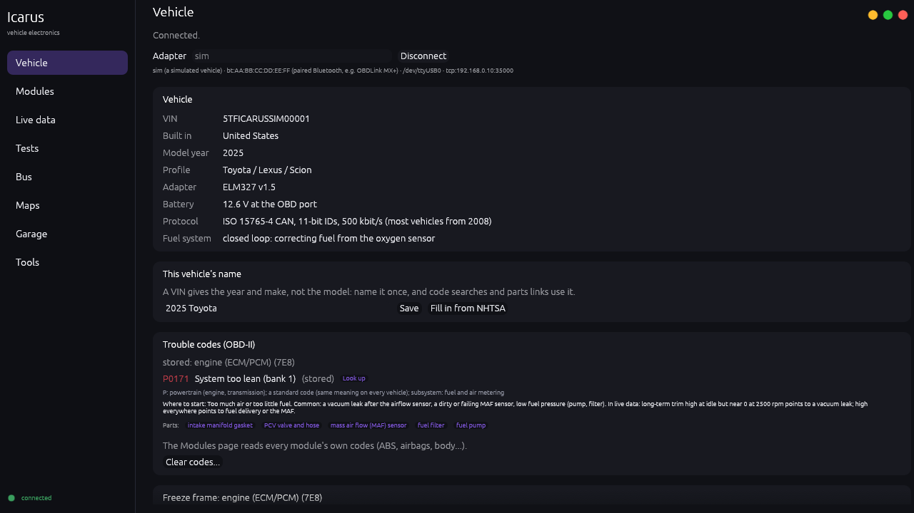
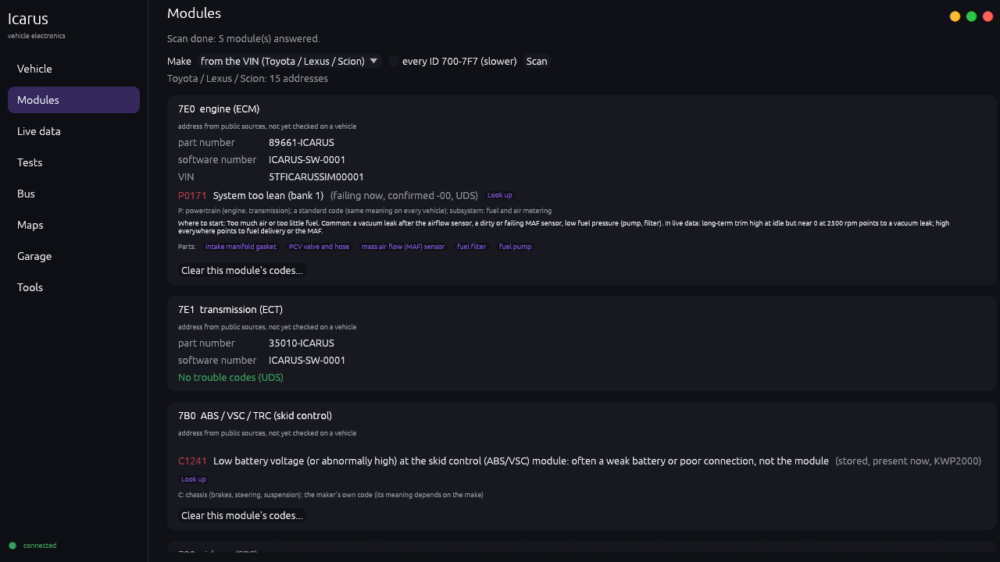
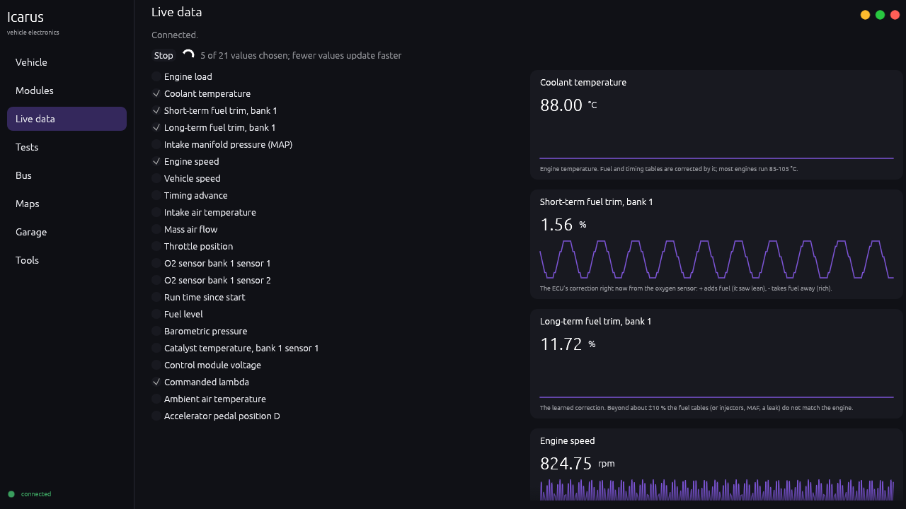
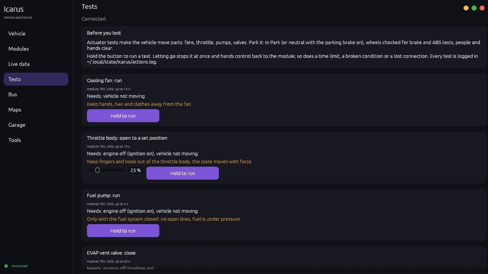
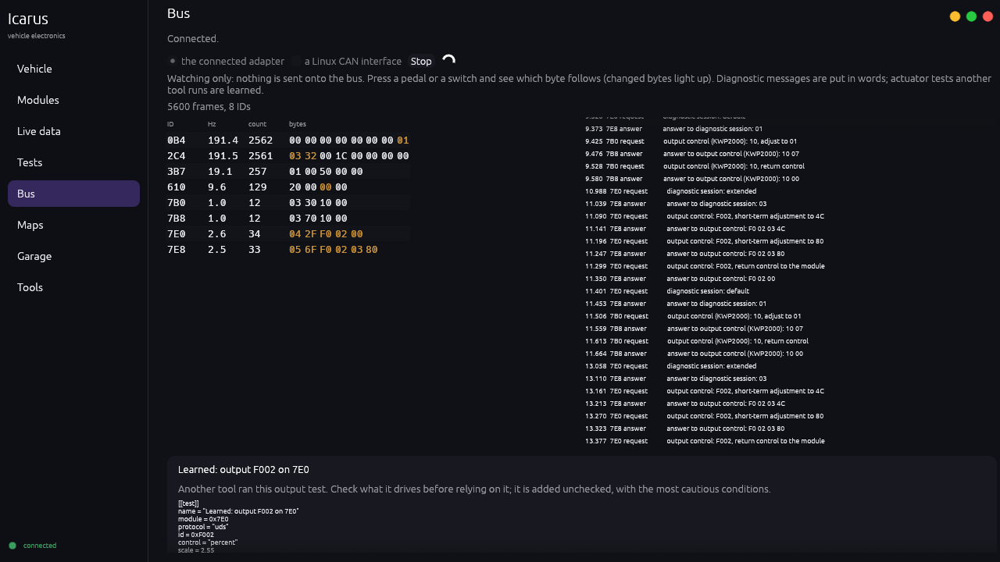
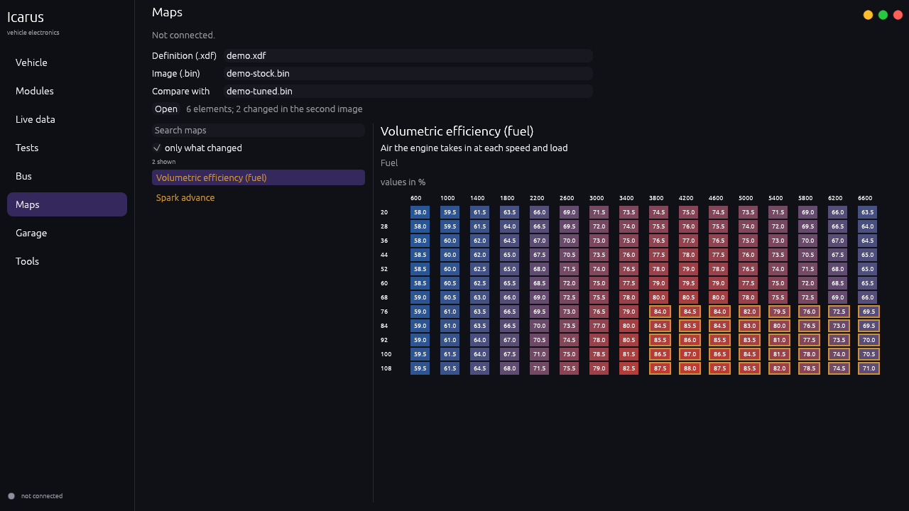
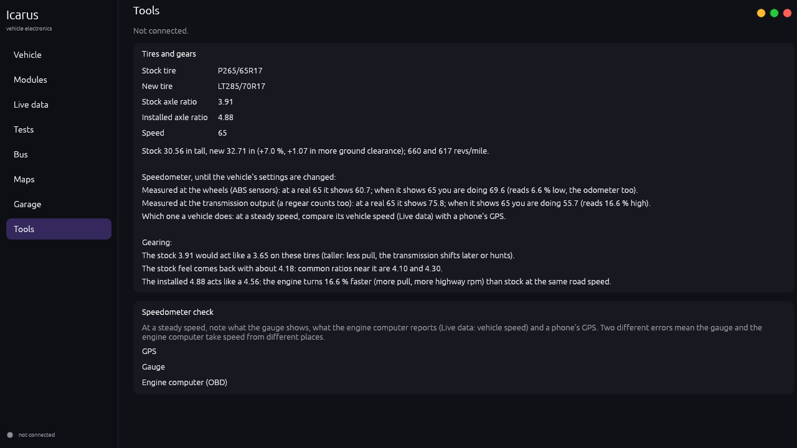

<p align="center"></p>

# Icarus

A vehicle tuning, learning and diagnostics tool for Linux: engine, transmission and other control modules (ECU, ECM, PCM,
TCM). I'm building it to learn vehicle electronics hands-on while I build off-road vehicles.

Part of the Artifex ecosystem (Labyrinth OS, Yggdrasil, Heimdall, Sarina, Daedalus...). Licensed MPL-2.0. Nothing from a real
vehicle is ever in this repository: no VIN, ECU image, calibration or log (the VINs in the tests are made up).

## Screenshots

On the simulated truck (`sim`) and a made-up demo engine; nothing from a real vehicle.

| | |
|:--|:--|
|  **Vehicle**: identity, codes explained with look-up and parts links, freeze frame, readiness |  **Modules**: every module's identity and codes, dealer-tool style |
|  **Live data**: values with what they mean, drawn as they change |  **Tests**: actuator tests, hold to run |
|  **Bus**: every ID and changing byte; another tool's tests learned |  **Maps**: a fuel table, cells another image changed outlined |
|  **Tools**: tires and gears, speedometer check | |

Maps shows, compares and edits tables (fuel, spark, limits): click a cell, type a value or step it, and save the result as a
new file (never over the original), its checksums corrected where they are known. Writing an image to an ECU comes only after
the rules in [docs/DESIGN.md](docs/DESIGN.md), on a bench ECU first.

## Install

Icarus is in Agora (Labyrinth OS's app store, under Utilities), or from Labyrinth's package repository:

```sh
sudo pacman -S icarus-git
```

The package (its recipe is Labyrinth_OS `packages/pkgbuilds/icarus-git`) builds this repository, runs `cargo test
--workspace`, and installs `icarus` and `icarus-app` in `/usr/bin`, Icarus in the app menu with its icon, and the tuner
access rules (`packaging/70-icarus-tuners.rules`, in `/usr/lib/udev/rules.d`). Updates come with the system's, through Agora
or pacman.

To try a checkout without the package:

```sh
bash scripts/install-local.sh            # builds, puts icarus and icarus-app in ~/.local/bin, Icarus in the app menu
bash scripts/install-local.sh --remove   # takes that out again (do this before installing the package: ~/.local/bin comes first)
```

## Trouble codes

Every code comes explained: what it means (standard codes in Icarus's own words, the maker's own codes from the vehicle
profile's `[codes]` table), what the letter and digits say, where to start for the common ones, the parts usually involved,
and, for all 9,533 standard codes, [OBDex](https://github.com/foerbsnavi/OBDex)'s depth (CC0, built in, no network):
what the module checks and when it sets the code, the causes from likely to rare, the symptoms, whether it lights the
check-engine lamp or can limit power, how hard the repair is, and related codes. Then links: a web search for the code on this vehicle, and searches for each part plus RockAuto's catalog for the vehicle.
Name a vehicle once (`icarus garage VIN "2017 Toyota Tacoma 3.5L V6"`, or the field on the Vehicle page) so the links name
the model. Searches go to DuckDuckGo unless `ICARUS_SEARCH` is a URL with `{q}`.

```sh
icarus dtc P0304 C1241 --vehicle "2017 Toyota Tacoma 3.5L V6"   # no vehicle needed
icarus obd codes --adapter A                                     # the vehicle's codes, explained, and the freeze frame
icarus obd report --adapter A --scan                             # everything in ~/Documents/Icarus/reports/*.md
```

The freeze frame (service 02) is what the engine was doing when the code set: speed, load, temperatures, fuel trims.

Every reading of a vehicle's codes (`obd codes`, connecting in the window) is kept in its folder
(`Logs/codes-history.tsv`), and the Vehicle page's Code history (or `icarus garage history VIN`) says when each code was
first and last seen, and since when it is gone (cleared, or its monitor passed).

On-board test results (`icarus obd selftests`, Mode 06, CAN vehicles): each emissions monitor's last measurement against
its limits (a catalyst near its limit fails soon) and misfire counts per cylinder; pass or fail compares raw numbers, real
units only where the scaling is certain.

Clearing (`icarus obd clear [--module ID]`, or Clear codes in the window) asks first, needs the engine off, and saves a
report before it erases anything: the freeze frame goes with the codes, and every readiness monitor starts over. Only the
clearing requests go out (OBD-II `04`, UDS `14 FF FF FF`, KWP2000 `14 FF 00`); permanent codes stay until their monitor
passes. Every clear is in `~/.local/state/icarus/actions.log`.

## NHTSA

`icarus vin VIN --nhtsa` (or "Fill in from NHTSA" next to the vehicle's name) asks NHTSA's public vPIC database for the
model, engine, trim and drive; it sends the VIN to NHTSA, so only when asked. `icarus recalls "2017 Toyota Tacoma"` (or the
Recalls card) lists the recalls on record for that year, make and model, sending only those three; whether one vehicle is
affected and still open is a VIN check at nhtsa.gov/recalls (the button opens it).

## Battery and charging

`icarus obd charging --battery agm` (or the Battery and charging card): the voltage the engine computer sees for about 20
seconds, judged for the battery fitted. Engine running: whether the alternator charges it well (an AGM wants about
14.4-14.8 V to finish a charge; under 13 V is not charging, over about 14.8 V overcharges). Engine off after sitting: about
how charged it is. A vehicle with battery management (BMW, VW/Audi, Mercedes, many newer Fords and Rams) also stores the
battery type, set by "battery registration": a per-make configuration change for later.

## Vehicle folders

Every vehicle connected (with a VIN) gets a folder in `~/Documents/Icarus/Vehicles/`, named after the name it was given
(else its VIN; renaming the vehicle renames the folder): **OEM tunes**, **Custom tunes**, **Definitions**, **Reports**
(the vehicle's reports go here) and **Logs**. A stock image imported as OEM is copied in read-only and never replaced: it is
the way back.

## The Read-Only switch

Each vehicle has a Read-Only switch on the Garage page (or `icarus garage read-only VIN on|off`), off by default. On, Icarus
still reads everything (codes, live data, module values, reports, recordings) and refuses to clear codes, run actuator
tests or change settings on that vehicle, before anything is sent. Each write reads
the VIN from the vehicle on the port at that moment, so the switch follows the vehicle; while any vehicle is switched, one
whose VIN cannot be read is refused too. Under the write features, the adapter link itself refuses any request that would
change a switched vehicle, whichever part of Icarus sends it: only reads (OBD-II 01-0A, KWP2000 and UDS 18, 19, 1A, 21,
22), tester present and the requests that hand control back (the default session, an output returned to its module) go,
so a test already running can always be ended. The Vehicle page's Writes line shows the connected vehicle's switch. The list is
`~/.config/icarus/read-only.toml`, on this computer only.

## Tires and gears

```sh
icarus tires P265/65R17 LT285/70R17 --gear 3.91 --installed 4.88
```

Taller tires: how far off the speedometer and odometer are (both cases: speed measured at the wheels, or at the
transmission output, where a regear counts too), what the stock and installed axle ratios act like, and which ratios bring
the stock feel back.

Saved for a vehicle (the Tools page's Save for this vehicle, or `icarus garage tires VIN P265/65R17 LT285/70R17 --at
transmission --gear 3.91 --installed 4.88`), its speed is shown corrected beside its own reading: on the Live data page,
and as a column of its own in `icarus obd live`. The settings are in `~/.config/icarus/tires.toml`, by VIN.

## GPS

Any GPS receiver that speaks NMEA 0183 (nearly all do): a USB one (`/dev/ttyACM0`, 9600 baud unless `@baud` is given), a
Bluetooth one (`bt:MAC`), or a phone app that shares its GPS over the network (`tcp:HOST:PORT`); `sim` stands in.
`ICARUS_GPS` sets the default.

```sh
icarus gps --gps /dev/ttyACM0                    # the fix, each satellite's signal, and what they say about the receiver
icarus gps speed --gps /dev/ttyACM0 --adapter A  # GPS speed against the vehicle's own, once a second, then the error
```

`icarus gps` diagnoses the receiver and its antenna: no sentences (wrong device or baud rate), garbled ones (a loose cable),
no satellites heard after a minute (the antenna disconnected, its cable damaged, or no view of the sky), only weak signals
(under 25 dB-Hz: the antenna or its cable), a 2D fix, poor precision. `icarus gps speed` is the speedometer check without
typing: a steady percentage off is a tire size or axle ratio change (`icarus tires` says which), and a vehicle that reports
no speed while GPS has it moving has lost its speed signal. The window has both on the Tools page (GPS: Listen 10 s, then
Use in the speedometer check). Positions are shown only with `--position`, and written only into a recording made with
GPS on purpose: `icarus obd live ... --csv FILE --gps SOURCE`, or Record drive with "with GPS positions" ticked on the Live
data page, add latitude, longitude and GPS speed columns (empty while there is no fresh fix). Nothing is sent anywhere.

## The bus

`icarus bus watch --adapter A [--protocol N]` (the OBDLink's monitor mode, silent; the adapter is set up on protocol N,
6 by default: CAN 11-bit at 500 kbit/s, without the protocol search's first request), `--can can0` / `--adapter can0` (a
Linux CAN interface such as a CANable) or `--adapter slcan:/dev/ttyACM0` (an SLCAN adapter: see below),
or the Bus page: every ID with its rate and last bytes, the bytes that just changed lit up (press a pedal or a switch and
watch which byte follows), what each ID is where the vehicle profile knows it (the modules' request and answer IDs,
OBD-II's own, and the IDs a profile's `[bus]` table names; the profile chosen on the Modules page, else the VIN's), and
diagnostic messages between a tool and the modules put in words. Watching only: nothing is sent onto the bus. What another tool does while Icarus watches is learned (next section).

**Heavy-duty vehicles (J1939).** Diesel trucks and buses, motorhomes on a truck chassis, farm and construction equipment
talk SAE J1939 on 29-bit CAN (usually 250 kbit/s). `icarus bus watch --adapter A --protocol A` (an adapter's J1939
protocol), or `--can can0 --j1939` / `--adapter slcan:...#250000 --j1939`, reads it: each module's active faults (DM1, put
back together from the transport protocol when longer than one frame) as SPN and FMI with their meaning, the warning lamps,
and the common engine values (engine speed, coolant temperature, vehicle speed, fuel rate, oil pressure), in °F, mph and psi
with the metric value beside. The layouts follow public descriptions of J1939-21, -71 and -73; SPN names cover a handful of
common ones (others show as their number). `--adapter sim:j1939` is a simulated truck to try it on.

**A CAN database names the bytes.** `--dbc FILE` reads a `.dbc` (a vehicle's from opendbc or a maker's; the file is yours,
never part of Icarus) and, after the ID table, shows each named ID's signals in its last frame, in their units and with
their named values ("DriverDoor open"): Intel and Motorola byte order, signed values, multiplexed signals, 29-bit IDs and
value tables are read; floating-point signals and lines that do not read are listed as left out. On the Bus page, the
same file (CAN database, Open) adds a signals column beside each ID's bytes, updated as they change.

**One device listens while another talks.** In Settings (the gear) each device gets a role: Talk, or Listen only (it is
never sent a request: Icarus refuses to talk through it, and sets it up without even the protocol search). On the Bus page,
"Listen with another device" watches through a listening device (the USB cable on a Y-splitter, say) while the connected
one talks: what Icarus sent stands beside the requests the listener saw, and a request Icarus did not send is another device
or program asking (the OBDLink app, VF Tuner). The capture is kept in the bus-watch format, for `icarus import buslog`. On
the simulator, `sim:listen` is a second adapter on the same simulated bus as `sim`.

SLCAN adapters (Lawicel CANUSB, a CANable with the slcan firmware, many cheap USB-CAN sticks) are watched without
`slcand` or root: `--adapter slcan:/dev/ttyACM0[@baud][#bitrate]` (115200 baud and 500 kbit/s unless given; `#125k`
for a medium-speed bus). Icarus speaks SLCAN on the serial port itself and opens the channel listen-only (`L`), so the
adapter acknowledges nothing; it never opens it in normal mode (`O`) and never sends a frame (the only commands sent are
`C`, `S0`-`S8` and `L`), and an adapter that refuses `L` is not watched through. `icarus learn` takes the same adapters.
They watch only: the `obd` commands refuse them.

## Learning from another tool

Icarus learns a vehicle's settings and output tests by watching another tool use them on it: a dealer tool, a shop scan
tool, a phone app that does customizations. A Y-splitter on the OBD port carries both: the other tool on one side, Icarus's
adapter (monitor mode) on the other, or a CAN interface tapped into the bus. Icarus only listens.

```sh
icarus learn --adapter A           # type what you are about to do in the other tool, Enter (a mark), then do it; "stop" ends
icarus learn --can can0 --ask-sarina
```

Or the **Learning** page: Start learning, type what you are about to do and press Mark before each change, Stop and save.

- **What is learned.** A write the module accepted (UDS `2E` answered `6E`, KWP2000 `3B` answered `7B`) becomes a
  `[[setting]]`, with the value the tool read just before (`22`/`21`) as "was" and the written one as "set", and whether
  the tool opened the extended session first. An output-control request (UDS `2F ... 03`, KWP2000 `30 .. 07`) becomes a
  `[[test]]`. A mark names the next one learned; one change per mark works best. Both are unchecked, with the most
  cautious conditions; the airbag modules and immobiliser, key and odometer settings are never learned.
- **What is not learned, but noted.** Security access (the tool unlocking a module), routines (service functions, coding
  steps), writes too long for a setting, memory writes and programming, and writes the module refused, each in words.
- **The session** is saved in the vehicle's `Logs` folder as `learning-DATE-TIME.md`: the module names from Icarus's
  profile, the marks, what was learned, what was noted, and every diagnostic message in words. No VIN.
- **Naming and adding.** On the Learning page each learned setting gets a name and names for its values ("was"/"set"
  become "on"/"off"), and one button adds it to the vehicle's file (`~/.config/icarus/vehicles/MAKE.toml`); the Module settings
  and Tests pages then offer it.
- **Sarina**, only when Sarina is installed (Sarina's own `sarina` program, not just Labyrinth's `labyrinth-ask-sarina`,
  which every Labyrinth system has; without Sarina the page says nothing about Sarina): Ask Sarina on a session (or
  `--ask-sarina`) has Sarina read the file
  (`labyrinth-ask-sarina`, read-only) and say what each setting most likely is, names for it and its values, and what the
  tool did that Icarus could not learn. Sarina's answer is a suggestion; the names are mine to give. Sarina can also open
  the sessions through `icarus mcp` (`learning_sessions`).

## Actuator tests (bidirectional controls)

Like the bidirectional controls of shop scan tools: Icarus asks a module to drive one output for a short while (throttle
to a set opening, cooling fan, fuel pump, a valve, the ABS pump) so the part can be checked.

```sh
icarus obd tests --adapter A                                   # the tests known for this vehicle
icarus obd test throttle --adapter A --value 30 --seconds 3    # asks "yes", runs, hands control back
```

In the window (Tests page) a test runs only while its button is held. The fence is in code (`crates/icarus-obd/src/
actuator.rs`): only output control goes out (UDS `2F`, KWP2000 `30`, the session and tester present they need); never
security access, routines, coding, clearing or programming; never airbag or occupant-detection modules; conditions (engine
off or running, vehicle stopped) checked before and every second during a test; at least 11.5 V; a time limit of at most
30 s; control handed back on every way out (release, time, condition, error, Ctrl+C, closed window), and by the module
itself if Icarus dies (its diagnostic session times out); every start and stop in `~/.local/state/icarus/actions.log`.

The tests are data: `[[test]]` entries in a vehicle profile (module, protocol, output ID, on/off or percent, conditions,
time limit, warning, a live value to watch). Their IDs are each maker's own, so a profile carries only IDs from a source,
marked `checked = false` until seen working; none are in the built-in profiles yet. `sim:off` (the simulated vehicle,
ignition on and engine off) has five to try: fan, throttle, fuel pump, EVAP vent valve, ABS pump.

## Service functions (relearns, resets, TPMS, coding)

A maker's routines a module runs (UDS routine control, `31`): throttle, idle and steering-angle relearns, oil life and
battery resets, TPMS sensor IDs, injector coding. Each is a `[[service]]` entry in the vehicle's profile (module, routine
ID, its parameters, whether it needs the extended session, whether to wait for its result, its conditions, `wired` for
coding). None are built in for a real make: a routine ID is each maker's own, and an unverified one could start anything,
so they come from the maker's service information or from watching another tool run one on my own vehicle (`icarus learn`
/ the Learning page turns a routine the tool starts into an unchecked entry).

```sh
icarus obd services --adapter A                                   # the vehicle's routines, and what each needs
icarus obd service "Throttle relearn (simulated)" --adapter sim:off --yes   # runs one (without --yes: says what it would do)
```

Running one checks first: the definition (never an airbag module), the Read-Only switch, a cable for coding, the battery
at 12 V or more, its conditions (engine off, parked...). Only the session (10 01/03), tester present and that routine's
own start, stop and result requests go out; its result is asked for until the module gives it or the time limit stops it;
the default session comes back whatever happened, and every run is in `~/.local/state/icarus/actions.log`. `sim:off` has
two to try.

## Basic, Advanced and Tuning

The window starts at **Basic**: the vehicle, its modules' codes, live data, logs, the garage and the tools, for diagnosing and troubleshooting. On the Vehicle page, **Scan my vehicle** is one button from connecting to every module's trouble codes, each in plain words with how soon it needs attention (serious, check soon, can wait) and what to check first, most urgent first: a starting point, not a diagnosis. The gear at the bottom of the side bar opens Icarus's own settings: **Advanced** adds the pages that control modules (Tests, Module settings, Learning, Bus), and **Tuning**, shown only while Advanced is on and turned on only after a yes, adds Maps. The same page holds the **units** (Imperial, Metric, both side by side, or as the system has it: Live data then shows "190 °F 88 °C"), the **theme** (the desktop's, dark or light), and what Icarus works with: the adapters and protocols, and the tuners and interfaces it recognises by their USB IDs (the table in docs/INTERFACES.md). The choices are kept per computer in `~/.config/icarus/window.toml`. The levels only show and hide pages: every change to a vehicle keeps its own checks, and a vehicle set to Read-Only in the Garage stays read-only at every level. The command line has everything. `icarus-app --page settings` opens the gear's page, `--page module` the Module settings page.

## What each vehicle answered

Every request Icarus sends to a single module, and what came back (data, a refusal and its reason, or no answer), is kept in
the vehicle's record: `record.json` in its garage folder (the simulated vehicle's in Icarus's state folder), one entry per
module and request with how often it was asked, when, and through which adapter. The window keeps it as it reads; the
command line after each command that asked single modules (it reads the VIN once to know the vehicle). What a vehicle
refuses, and why, is data a later connection learns from: a read it refused for good (service not supported, sub-function
not supported, an identifier that does not exist there) is not asked again, and the same refusal comes back without asking;
a busy or conditional refusal is asked again, and nothing about security access, tests, clearing or writing is ever
skipped. `--fresh` (or the Modules page's every-request-ID scan) asks everything again. It stays on this computer: nothing of it goes into this
repository.

## Module settings

What dealer tools call customizations: a feature a module keeps switched on or off, or a value it keeps (a chime, a lock
behaviour, a light). Icarus learns them by watching such a tool change one on my own vehicle (previous section), and then
changes them itself, on the Module settings page (asks first, with the value now and the one chosen) or:

```sh
icarus obd settings --adapter A                                # the settings known for this vehicle, and each one's value now
icarus obd setting "seat belt chime" off --adapter A           # asks "yes", keeps the value before, writes, reads it back
icarus obd setting-undo "seat belt chime" --adapter A          # back to what it was before the last change
```

The fence is in code (`crates/icarus-obd/src/settings.rs`): only reading and writing one data identifier goes out (UDS
`22`/`2E`, KWP2000 `21`/`3B`, the session they need and tester present); never security access, routines or programming;
never airbag or occupant-detection modules, immobiliser or key settings, or odometer values. A change needs a wired adapter
(not Bluetooth or Wi-Fi), the battery at 12 V or more, and its conditions (by default engine off and parked). The value
there before is read and written to the vehicle's `Logs/settings-changes.tsv` before anything is written; the new value is
read back, and if the module did not take it, the old one is written back. Only named values from the profile can be
written: a value never seen on the vehicle goes into its profile first, by hand. Every change is in
`~/.local/state/icarus/actions.log`.

Settings are data too: `[[setting]]` entries (module, protocol, identifier, named values, whether the module needs the
extended session, conditions). None are in the built-in profiles: each maker's are its own, and each module's differ by
model and year, so they come from watching a tool on my own vehicle. `sim:off` has two to try: the cluster's seat belt chime
(UDS) and the ABS module's buzzer (KWP2000).

## Module data (each module's own values)

What a dealer tool shows as a module's data list (Techstream, DDT2000): transmission fluid temperature, knock correction,
wheel speeds... values the standard OBD-II list does not have. Icarus reads them, for any make, from definition files: each
says which read-only request to send a module and what the bytes of its answer mean. Icarus ships no third-party data; you
import a file you downloaded. The window reads them too (Modules page: Module data, "Read module data"), and so can Sarina
or another assistant (`icarus mcp`'s `module_data`), with the same set chosen the same way and the same gates:

```sh
icarus import obdb ~/Downloads/Toyota-Tacoma/signalsets/v3/default.json   # an OBDb signal set (github.com/OBDb)
icarus import abrp ~/Downloads/ev-obd-pids/hkmc/Ioniq5.json --model "Ioniq 5"  # an EV's PID list (A Better Routeplanner)
icarus data                                     # the sets you have; icarus data SET --module 701 lists one module's values
icarus obd data 701 --adapter A                 # the transmission's values now (US units where those are the custom)
icarus obd data 700 701 --adapter A --every 1000 --csv drive.csv   # watch them, paced, into a CSV
icarus obd data --check 701 VALUE_ID --note "matched the gauge" --adapter A   # mark a value as right on this vehicle
```

An import goes to `~/.config/icarus/data/SET/` (a `set.toml` and one TOML file per module, which can also be written by hand
and checked with `icarus data check FILE.toml`). The set is chosen by the VIN's make, the model year and the model (the
vehicle's name from `icarus garage`; a set's model, such as OBDb's "F 150", must appear in it as whole words), or `--set`:
when one of them is not known, no set is guessed. What each request did on a vehicle (answered, refused as not there, too
short) and the values checked on it are kept in its folder, `Definitions/module-data.toml`; a vehicle whose VIN could not
be read keeps them for the run only.

OBDb's signal sets are CC BY-SA 4.0: Icarus reads your copy and shows "signal data: OBDb (github.com/OBDb), CC BY-SA 4.0"
wherever those values appear; none of OBDb's data is in this repository.

A Better Routeplanner's EV PID lists ([ev-obd-pids](https://github.com/Iternio-Planning-AB/ev-obd-pids), Apache-2.0)
give electric and hybrid vehicles' battery values: charge, health, current, voltage, temperatures. Their equations are in
Torque Pro's style; Icarus works out what each one is by evaluating it (a scaled number from consecutive bytes, signed or
not, or one bit, or a yes/no test over one byte such as `(A==1)||(A==2)`, kept as yes or no for every raw value) and
keeps only those, so nothing is guessed. Yes/no tests over several bytes, raw CAN frames and 29-bit modules (VW, Renault,
Honda, so far) are listed as left out with the reason. Modules at 7E0-7E7 (OBD-II's powertrain
addresses) are read; any other address follows the airbag rule in the gates below. `icarus import ddt ECU.xml` reads a DDT2000 ECU file
you have (Renault, Dacia, Nissan; Renault's material, never shipped with Icarus): only its reading requests (`22`, `21`,
`1A`, with no data sent and no access rules) and their values come in, each marked unverified; K-line modules and anything
that writes are listed as left out. DBC bus files are read by `icarus bus watch --dbc` and the Bus page.

The fence is in code (`crates/icarus-obd/src/moddata.rs`), checked when a set is loaded and again before every request:
services 21 and 22 only, built by Icarus from the identifier (files carry no raw bytes; a file may also name `1A`,
identification, which is kept for a later build and never sent today); never on 7DF or any answer ID; airbag and occupant
modules identity only, and on a make whose profile names no airbag module, a module of unknown kind gets nothing either;
nothing that needs a diagnostic session is sent (Icarus opens none); at least 50 ms between any two sends, a busy module
slowed, a refused request, one that keeps failing or a silent module dropped. Modules behind a gateway that answer
with their own address byte first (Toyota's 750: tire pressure 2A, as OBDb's Tacoma set has it) are read through the
adapter's extended addressing; a gateway whose answers carry another byte (BMW's), 29-bit IDs and K-line are listed as
not reachable yet. `--adapter sim` has a set of
its own (made-up identifiers on 700, 701 and 7E0) to try it on.

## Learning module data from a capture

Another tool that already knows the vehicle shows which identifiers each module answers. Icarus reads a recording of it
at work: a phone's Bluetooth log of an app talking to its adapter (`idevicebtlogger` on Linux, with Apple's Bluetooth
logging profile on the iPhone), or a bus log taken through a Y-splitter (`icarus bus watch --raw`, `candump`):

```sh
idevicebtlogger -f pcap obdlink.pcap                     # while the app runs on the vehicle; Ctrl+C stops
icarus import btlog obdlink.pcap --make toyota --transcript obdlink.csv
icarus import buslog drive.log --make toyota             # a bus log; either name reads either kind of file
icarus data obdlink --sample                             # each identifier and the answers seen
icarus data name obdlink 7E0 RAW_22_1234 --name "Coolant temperature" --byte 1 --bits 8 --add -40 --unit °C
```

It gives a transcript (CSV: time, module, request, answer, to match against a screen recording of the app) and a
module-data set: every identifier a module answered on a data read (`22`, `21`) becomes a request with one unnamed
placeholder value over its answer's bytes, not verified, with the answers seen as samples. Identity reads (`1A`) are
listed as seen, not imported (identity comes in a later build). Writes, tests, routines,
clearing and security access the tool did are listed as seen, never imported; the gates of `icarus obd data` apply (airbag
modules identity only, never 7DF or an answer ID). **Privacy:** only the OBD conversation is kept. Bluetooth addresses,
device names, link keys and every other Bluetooth channel are never written to any output, adapter commands are counted
but not kept, and VINs (in answers and in requests, also split over several messages) are masked in the transcript and
the set unless `--keep-vin`. How to capture, what is read and how
to name a value afterwards: [docs/CAPTURES.md](docs/CAPTURES.md).

**Suggested names.** `icarus obd suggest [MODULE...] --adapter A [--set SET] [--seconds 60]` reads the standard values
(engine speed, load, temperatures, throttle, voltage...) and the set's requests in turn, through the same gates and pacing
as `icarus obd data`, then compares every byte and pair of bytes no value names (a capture's placeholders) with each
standard value: one that rises and falls with it (Pearson's r 0.98 or more over 20 reads or more) is suggested as it, with
the scale, for example `700 22 1F06, bytes 1-2 (16 bits): follows engine speed (r 1.000 over 369 reads): engine speed = raw
x 0.5004 - 0.4998 rpm` on the simulated vehicle. A value that only rose while compared is marked, since a counter fits
that as well.

Values that change with something done (a door, the brake pedal, the lights) are named by **marks**: while it reads, type
what you are doing as you do it ("brake pressed", Enter; Enter alone counts "mark 1", "mark 2"). A bit (or a byte, when
several of its bits change) that changed within 2 s before to 5 s after every mark of a name, at most twice a mark, and at
no other time, is suggested as that: `700 22 1F07, byte 1 bit 0: changed with "brake pressed" (2 of 2, 0 to 1), "brake
released" (2 of 2, 1 to 0) and at no other time` on the simulated vehicle. Do each thing twice or more, with time between;
bytes already matched to a standard value are left out. Every suggestion is a guess to check (then `icarus data name` it);
nothing is written.

## Editing maps and checksums

```sh
icarus set IMAGE.bin FILE.xdf "Volumetric efficiency (fuel)" 88 --row 9 --col 10   # a table cell (rows and columns from 0)
icarus set IMAGE.bin FILE.xdf "Rev limit" 7200                                     # a single value
icarus set IMAGE.bin FILE.xdf "Cooling fan on at idle" off                         # a switch
icarus checksums IMAGE.bin FILE.checksums.toml                                      # are the checksums right?
```

Every edit is saved as a new file (`IMAGE-edited.bin` beside it, or in the vehicle's Custom tunes folder when the image is in
its OEM tunes folder; `--out` to choose), never over a file. In the window, the Maps page does the same: click a cell, type a
value (or step it with - and +), Undo this map / Undo all, Save. A table shows as its cells, as a 2D graph (a line per
row) or, for a map, as a 3D surface that turns as you drag it; pointing at a value reads it, clicking it picks that cell to
change.

**Versions.** "Stock" is the original image, never changed; a version is a name and the changes against it, kept as a
small file (`<image> - <name>.version.toml`, the changed bytes with the original's bytes beside them, the original named
by its size and CRC-32) in the same folder as edits, never over another file. On the Maps page, "Keep the edits as a
version" saves one, the Versions row shows what each changes against stock (the changed maps listed, their cells
outlined), "Edit from it" goes on editing from a version, "Rename" gives the version shown the name typed in the name box
(never over another version), and "Delete" removes its file after asking (stock and the other versions stay). `icarus set
... --version NAME` keeps a single change as a version instead of writing an image. A version only applies to the image it was made from, and
makes the full image again whenever asked; its checksums are corrected then, as for any edit.

```sh
icarus version new STOCK.bin TUNED.bin "Cold start" --def DEF   # keep what a tune changes as a version of stock
icarus version list STOCK.bin                                     # stock and its versions
icarus diff STOCK.bin "STOCK - Cold start.version.toml" --def DEF # what the version changes, map by map
icarus version image STOCK.bin "STOCK - Cold start.version.toml" --def DEF   # its full image, as a new file
icarus set STOCK.bin DEF "Spark" 21 --row 0 --col 1 --version "Tow"           # one change, kept as a version
icarus version rename STOCK.bin "STOCK - Tow.version.toml" "Towing"            # another name for it
icarus version delete "STOCK - Towing.version.toml"                            # its file removed; stock stays
```

Formulas that use other values (a TunerPro `VAR` linked to another element, or to a raw number at an address) are worked
out with those values as they are in the image, the values they use first. Editing such a cell stores the number that shows
the value typed with the linked values as they are now; changing a linked value later changes what the cell shows, and a
tune that changes it shows every map that uses it as changed. Formulas that use each other in a loop, or a link to an
element that is missing or not a single value, are left out with the reason; a cell whose formula no longer depends on the
stored number (a linked value of 0 in `X*Y`) is refused.

Checksums: an ECU checks its calibration against numbers kept in the image, so an edited image needs them corrected. How each
family computes them is its own; a definition's checksums are described in `<definition>.checksums.toml` beside it (sums of
bytes, 16- or 32-bit words, XOR, CRC-16/CCITT, CRC-32; stored as the value or as the complement that makes the sum come out
right; the format is at the top of `crates/icarus-core/src/checksum.rs`). A description is used only if it matches the image
as it was read; one that does not is reported and never "fixes" anything. With no description the checksums are unknown and
the saved file is for study only. No family's description ships yet: each needs a source and a check on a real image.

## Sarina (or another assistant)

`icarus mcp` is a Model Context Protocol server on stdin/stdout with seven read-only tools: `explain_code` (what a code
means, where to start, the parts), `vehicle_check` (identity, check-engine light, readiness, codes explained, freeze frame,
current values, on-board test results), `vehicle_modules` (every module's codes), `module_data` (each module's own
values), `learning_sessions` (what Icarus saved while watching another tool), `drive_logs` (recorded drives summarized)
and `tires_gears`. Nothing that clears
codes, runs a test or writes is offered to a model; a test fails if a tool with such a name appears. The adapter comes from
`ICARUS_ADAPTER` in the server's environment (`sim` for the simulated vehicle). For Sarina, a definition file of its own:

```json
{"mcpServers": {"icarus": {"command": "/home/me/.local/bin/icarus", "args": ["mcp"],
  "env": {"ICARUS_ADAPTER": "bt:AA:BB:CC:DD:EE:FF"}, "read_only": true, "timeout_seconds": 120}}}
```

named by `SARINA_MCP_FILE` when Sarina should have it (in `~/.sarina/mcp.json` Sarina's nightly evals would see the five
tools too).

## The window

`icarus-app` (Icarus in the app menu): the **Vehicle** page connects to the adapter and shows the VIN, the make's profile,
the codes explained with Look up and parts buttons, the freeze frame, the check-engine light and readiness monitors, the
vehicle's name, and Save report; **Modules** scans every module for its identity and codes;
**Live data** picks values (one by one, or Select all and Clear selections) and draws them as they change, each with what it means; **Trail gauges** shows the trail values the vehicle gives (coolant, oil and intake temperatures, voltage, engine and road speed, load, fuel level, outside air, air pressure) as big readouts in your units, each outlined amber when it wants watching and red when it is time to stop (general bands for a petrol engine: coolant from 230 °F and 245 °F, voltage under 12.0 V and 11.5 V or over 15.0 V and 15.5 V...), with the lowest and highest since they started and road speed corrected for the tires; **Tests** runs actuator tests while a
button is held; **Settings** shows each module setting's value and changes it (asks first; undo puts the last change
back); **Learning** watches another tool and names what it learned; **Bus** shows every ID and message; **Maps** opens a
definition and an image
(and a second image or a version to compare: it starts on the first map that changed, changed cells outlined; tables as
cells, a 2D graph or a 3D surface; versions of the image); **Logs** summarizes a recording (fuel trims by driving
condition, with fuel cut while coasting and the warm-up counted apart and left out), charts it on one time line, lays a chosen value out over engine speed and load like a tuner's table (each cell
the mean of its readings), and draws the drive's GPS track coloured by speed when it was recorded with GPS (the shape only:
no map is fetched). Start options:
`--connect [--adapter A] --page modules --scan`, `--live`, `--page trail --gauges`, `--maps DEF.xdf|.a2l IMAGE.bin [SECOND.bin|VERSION.version.toml]` with `--map NAME` and `--view cells|2d|3d`, `--learn [--mark TEXT]
[--learn-seconds N]` (a learning watch at start, for demonstrations).

## What it does today

Everything below only reads, except the actuator tests, which drive a part for as long as you hold the button, and module
settings (both above).

**Files** (no vehicle needed):

```sh
icarus def DEF [--find TEXT]                      # what a definition describes; --find searches map names
icarus show IMAGE.bin DEF NAME                    # one map, curve or value from an image, in real units
icarus diff ORIGINAL.bin TUNED.bin --def DEF      # what a tune changed, map by map and cell by cell
```

`diff` is the quickest way to learn from an existing tune: give it the stock image and a modified one, and it names every
map that changed and shows each cell's old and new value.

A definition (DEF) is a TunerPro `.xdf` or an ASAM MCD-2 MC `.a2l` (ASAP2, what calibration tools use); Icarus tells them
apart by their contents, and both work the same everywhere (`def`, `show`, `set`, `diff`, the Maps page). From an A2L it
reads `CHARACTERISTIC`s of type `VALUE`, `CURVE`, `MAP` and `VAL_BLK` (a block of values, `NUMBER` or a two-dimensional
`MATRIX_DIM`, shown as a table with numbered rows and columns) with their record layouts (`FNC_VALUES` row or column order,
`AXIS_PTS_X/Y`, alignment, byte order), `COMPU_METHOD` `IDENTICAL`, `LINEAR`, `RAT_FUNC` (the form with one real value
per stored number) and `FORM` when its formula is plain arithmetic in `X1` (numbers, `+ - * /`, parentheses), fixed axes, shared axes (`COM_AXIS` and its `AXIS_PTS`, which are listed as elements too) and axes stored
with the values; `FUNCTION`s become categories. The image is taken to start at the A2L's lowest memory segment that is not
RAM (`icarus def` prints the offset). Everything else (conversion tables, formulas with functions, bit operators or a second
input, bit masks, 64-bit integers, point counts stored in the image, rescale and curve axes, three-dimensional blocks,
`/include`d files, keywords it does not know) leaves that element out, listed with the reason, rather than guessed.

**Vehicle**, through an OBD-II adapter:

```sh
icarus obd info  --adapter A    # adapter, protocol, VIN, modules, calibration IDs, check-engine light, readiness monitors
icarus obd codes --adapter A    # stored, pending and permanent trouble codes per module
icarus obd pids  --adapter A    # the live values each module offers, and what each one means
icarus obd live  --adapter A 0C 06 07 14 44 --csv run.csv   # watch values (PIDs in hex), optionally into a CSV log
icarus obd scan  --adapter A --make toyota   # every module (ABS, airbags, cluster...): identity and trouble codes
icarus obd module 7B0 --adapter A            # one module, by its request ID
icarus obd asbuilt 726 --adapter A           # a module's as-built configuration block, saved in the vehicle's folder
```

Live values (`obd live`, Live data and Record in the window) go up to six to a request on CAN vehicles, as SAE J1979
allows: one wait for the modules' answers instead of six, each answer split by the values' known lengths (one that does
not split exactly is not read, and a module that refuses several at once is asked one value at a time). Older protocols
allow one value a request.

After its first minute, `obd live` stops asking for a value the vehicle never answered, and for one that equalled an earlier
value at every reading while both changed (a vehicle may list PID 46 ambient and never fill it, or answer PID 3D catalyst
bank 2 with a copy of 3C), and says which it dropped; the column stays in the log, empty, and the other values are read more often. Two values
that only sat at the same number (fuel trims at 0 while the engine warms) are not copies and stay. `--all` asks every value
the whole time. The window's Record drive does the same for the values it reads in turn: one asked at least three times in
the first minute without an answer is no longer read, and the status line says so (copies are not judged there: those
values are read at different moments).

`scan` and `module` work like a dealer tool (Techstream, FORScan): they talk to each module directly in UDS (ISO 14229) or
the older KWP2000 that many Toyota modules still use, not only to the engine's standard OBD-II side. A guard in the code lets
only reading services out: clearing codes, writing, actuator tests and programming are refused until the safety steps exist.
Modules behind a gateway (Toyota's body modules at 750, each with its address byte: main body 40, tire pressure 2A) are
reached with the adapter's extended addressing (`ATCEA`): their identity and codes, read only, with no Clear button. An
adapter that shows the address byte in answers and one that strips it are both read.
`asbuilt` reads a module's whole as-built configuration block (FORScan's name for Ford's identifiers DE00 on: `22` reads
only, until the first one the module does not have) and saves it in the vehicle's `Definitions` folder, never over an
earlier one: the way back before any configuration change. It never sweeps an airbag or occupant module, and a chassis or
driver-assist module (ABS and stability control, brakes, steering, radar, cameras, cruise, lane and parking assistance:
by its kind or name in its module-data file, or by the name the vehicle's profile gives its address, such as Toyota's 7B0
and 7A1) gets identity only, unless its file in the vehicle's module-data set (`icarus data`, chosen as `obd data` chooses
it, or `--set`) lists identifiers DE00-DEFF: then exactly those are read. Each refusal says why, and nothing is sent.
`scan --sweep` (and a profile's module with no answer ID written down) does not take a module's answer ID to be its
request ID + 8: the probe (tester present, `3E`) listens to every diagnostic ID, 700-7FF (`18DAF1xx` on 29-bit CAN), on
a CAN interface, the Mongoose, and an ELM327 or OBDLink (its receive filter opened for the probe only: `ATCF700` and
`ATCM700`, or `STFAP` on the STN chip). Only an answer to the probe counts, not from another module's answer ID, and one
heard from elsewhere than the guess is asked once more there before it is believed; the module is then read at that
answer ID, and no answer ID heard is ever sent on in that scan. Through the OpenPort (a J2534 channel takes in only the
IDs it has a filter for) the probe still listens at the request ID + 8 only.
On a vehicle whose OBD-II runs on 29-bit CAN (most Hondas), modules are asked at their 29-bit IDs (`18DAxxF1`, answered
from `18DAF1xx`; `ATCP` and `ATSH` set the header): a scan asks the engine and transmission at `18DA10F1` and `18DA18F1`,
`--sweep` every `18DAxxF1`, and `icarus obd module 18DA30F1` one of them. A profile can name a range of request IDs
answered a fixed distance away: GM's body modules (requests `240`-`24F`, answers 400 higher) are asked that way, each named
by its number. 29-bit modules and GM's body range are read only, with no Clear button.
A module written down with `bus = "ms-can"` (Ford's medium-speed CAN on pins 3 and 11) is asked through an OBDLink: Icarus
switches the STN chip to that bus (`STP53`) for that module's requests only and back to the vehicle's own protocol
(`ATSP6`) afterwards, whatever happened (a failed way back is tried again before the next request); a plain ELM327 lists
such a module as not reachable, with the reason. A request longer than one CAN frame goes as `STPX` on an OBDLink and is
refused on a plain ELM327. These STN commands are from the STN11xx/STN22xx reference and have been tested on the
simulator only (`elm::STN_UNVERIFIED`).
A module's codes are asked for in every read-only form in turn (UDS `19 02` with the status masks FF, 2F, 09 and 08;
KWP2000 `18` with status 02 and 00; ISO 14230 `13` with and without the group), since modules refuse the forms they do not
support; when none gives them, Icarus shows what each request got (no answer, or the module's refusal and its reason).

**Vehicles.** Icarus is for any make: what it knows about each one (where its modules answer, its quirks) is a small TOML
file in `crates/icarus-obd/vehicles/`, picked by the VIN. Built in: Toyota/Lexus, Subaru, Ford/Lincoln, GM, Stellantis,
Honda/Acura, Nissan, Hyundai/Kia, Mazda, VW/Audi, BMW/Mini, Mitsubishi, and a generic OBD-II profile. A file of the same name
in `~/.config/icarus/vehicles/` replaces a built-in one, and a new name adds a make, so a module found on a vehicle can be
written down without rebuilding. Addresses from public sources are marked "not yet checked" until seen on a real vehicle.

```sh
icarus vin VIN       # where it was built, maker, model year, check digit
icarus vehicles      # the makes Icarus knows
```

The adapter `A` is one of:

| | |
| --- | --- |
| `sim` | a simulated vehicle (engine + transmission, a P0171 lean code to diagnose): try everything without a car |
| `bt:AA:BB:CC:DD:EE:FF` | a paired Bluetooth adapter such as the OBDLink MX+ (RFCOMM channel 1; `#2` picks another) |
| `/dev/ttyUSB0[@115200]` | a USB adapter (38400 baud unless given) |
| `tcp:192.168.0.10:35000` | a Wi-Fi adapter |
| `can:can0` (or just `can0`, `vcan0`) | a Linux CAN interface (SocketCAN), such as a CANable set up with `ip link set can0 up type can bitrate 500000` |
| `slcan:/dev/ttyACM0[@baud][#bitrate]` | an SLCAN adapter, for watching the bus only (listen-only; see The bus) |
| `openport` (or `openport:/dev/ttyACM0`) | a Tactrix OpenPort 2.0 J2534 cable, through Icarus's own driver for it (docs/INTERFACES.md) |
| `mongoose:/dev/ttyACM0` | a Drewtech Mongoose Pro J2534 cable on that port, through Icarus's own driver (11-bit CAN; docs/INTERFACES.md) |
| `sim:j2534` | the simulated vehicle behind a simulated J2534 device |

`ICARUS_ADAPTER` sets a default.

Through a CAN interface Icarus speaks ISO 15765-2 (ISO-TP) itself over raw frames, with no ELM327 in between and no kernel
`can-isotp` module: OBD-II's broadcast on `7DF` (or `18DB33F1`; it tries 11-bit CAN, then 29-bit), each module at its own
IDs, long answers and requests put together and split with flow control both ways, "response pending" waited out, a
message that stops halfway reported, never kept short. The `obd` commands work the same (`icarus obd info --adapter can0`);
the interface cannot measure the battery, and its bit rate is whatever `ip link` set: Icarus asks the kernel for it (over
rtnetlink) and names it beside the interface, and at 250 kbit/s the protocol is ISO 15765-4's 250 kbit/s one. As on every link, a request that
would change a vehicle switched to Read-Only is refused before any frame is sent. Pair a Bluetooth adapter once with `bluetoothctl` (`scan on`, `pair`, `trust`); Icarus
connects to it directly, no `rfcomm bind` needed.

## Build

```sh
cargo test --workspace
cargo build --release      # target/release/icarus
```

Rust (stable), Linux. Dependencies: `roxmltree` (XML) and `libc`.

## Layout

| Crate | What |
| --- | --- |
| `crates/icarus-core` | ROM images (original + edited, diff), definitions (tables, values, switches), formulas, the TunerPro `.xdf` and ASAM `.a2l` readers; module-data definitions, their decoder, the OBDb importer and the capture importers (Bluetooth logs, bus logs); ISO-TP |
| `crates/icarus-obd` | adapters (USB, Bluetooth, Wi-Fi, simulated), the ELM327/STN language, Linux CAN interfaces with Icarus's own ISO-TP, the standard OBD-II services |
| `crates/icarus` | the `icarus` command |
| `crates/icarus-app` | the window (egui, Yggdrasil's look from yggdrasil-ui); a worker thread owns the adapter |

## Design and limits

What Icarus is built to do, the rules every write follows, and its known limitations: [docs/DESIGN.md](docs/DESIGN.md).

## What Icarus will not do

- Ship one-click emissions "delete" features. Thresholds and calibration values (what sets what off) are ordinary maps, and
  emissions readings (oxygen sensors, lambda, fuel trims, catalyst temperature, monitors) are part of the live data.
- Bypass immobilizers or change odometer readings.
- Flash or recode a module without a verified full backup first (the writes so far: actuator tests, clearing codes and
  module settings, each with the value before kept and a way back).

## Version

`VERSION` is Icarus's own version (1.0.0 since 2026-11-11, its first numbered release), for when it is packaged. How the numbers work and how to make a release: [Labyrinth_OS docs/VERSIONING.md](https://github.com/Artifex-Technologies/Labyrinth_OS/blob/main/docs/VERSIONING.md).

## Artifex Ecosystem

| Repository | What it is |
| --- | --- |
| [Labyrinth_OS](https://github.com/Artifex-Technologies/Labyrinth_OS) | privacy- and security-first Linux distribution (CachyOS-based), made for gaming too |
| [LykanOS](https://github.com/Artifex-Technologies/LykanOS) | the security edition, built on the same desktop and tools |
| [Yggdrasil](https://github.com/Artifex-Technologies/Yggdrasil) | the desktop environment both systems use (panel, Settings, Agora, Minos, the compositor) |
| [Sarina](https://github.com/Artifex-Technologies/Sarina) | optional local AI assistant that runs on this computer |
| [Heimdall](https://github.com/Artifex-Technologies/Heimdall) | the security agent: watches the computer, its network and Sarina |
| [Limbo](https://github.com/Artifex-Technologies/Limbo) | disposable sandboxes for apps, Windows programs and untrusted files |
| [Kairos](https://github.com/Artifex-Technologies/Kairos) | frame generation for games (a Vulkan layer) |
| [Argus_App](https://github.com/Artifex-Technologies/Argus_App) | desktop console for the Flipper Zero (a qFlipper fork) |
| [Argus_Firmware](https://github.com/Artifex-Technologies/Argus_Firmware) | Flipper Zero firmware fork |
| [Daedalus_CAD](https://github.com/Artifex-Technologies/Daedalus_CAD) | 3D modelling and CAD (SketchUp-style) |
| [Icarus](https://github.com/Artifex-Technologies/Icarus) | **this repository**: vehicle diagnostics and tuning |

## Licence

MPL-2.0, like the rest of the ecosystem. The reference projects I looked at are GPL or proprietary: Icarus takes ideas and
file formats from them, never code. The projects I share are references in the same way, whatever their license: nothing is
copied from them, and [docs/REFERENCES.md](docs/REFERENCES.md) credits what Icarus learned from each. The one exception I
chose is OBDex's public-domain (CC0) trouble-code texts, which Icarus bundles.
