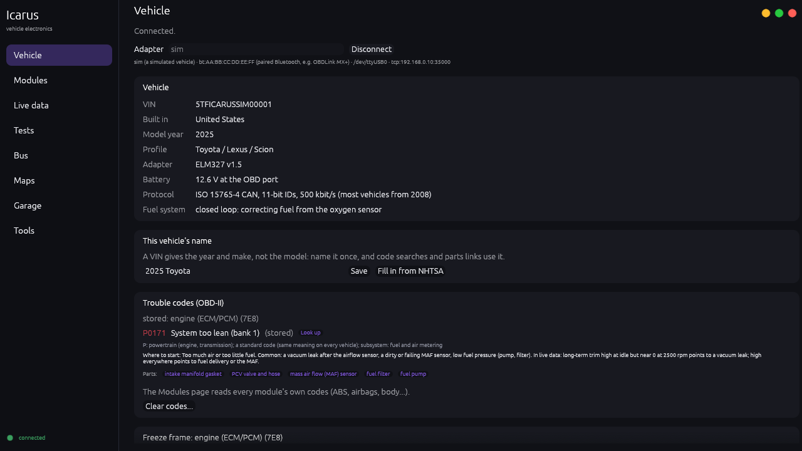
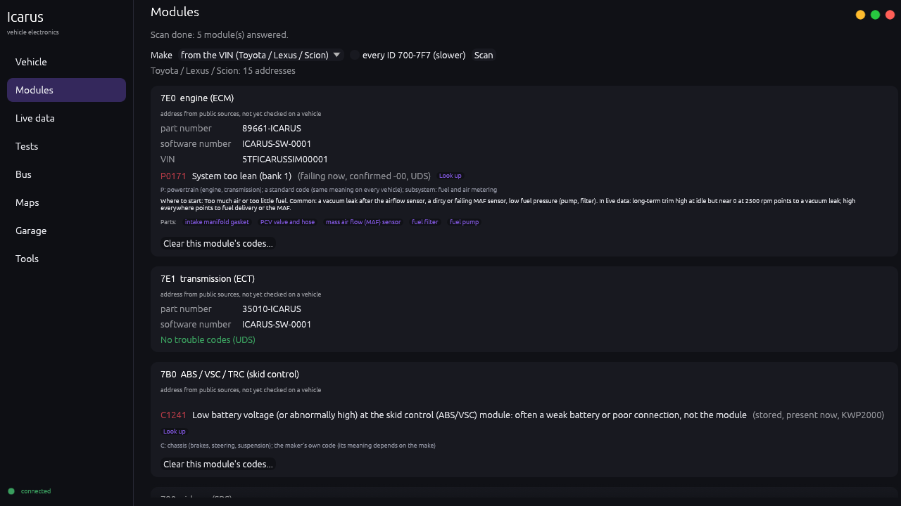
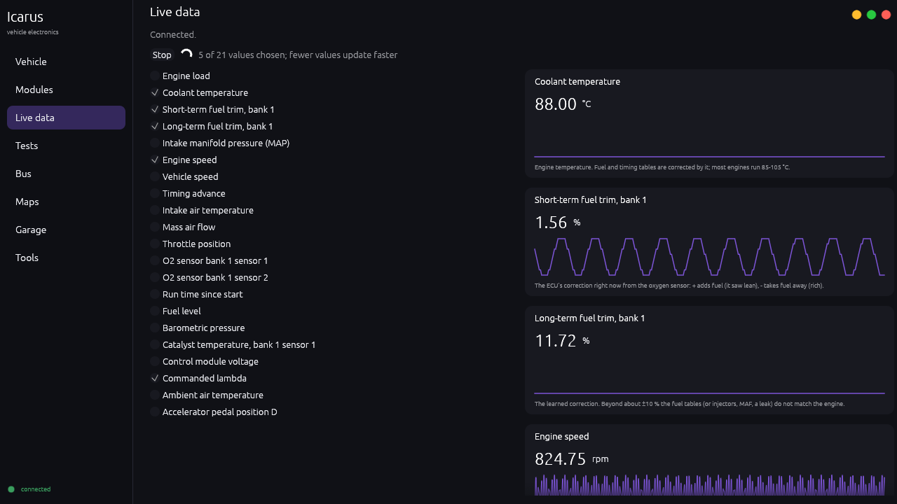
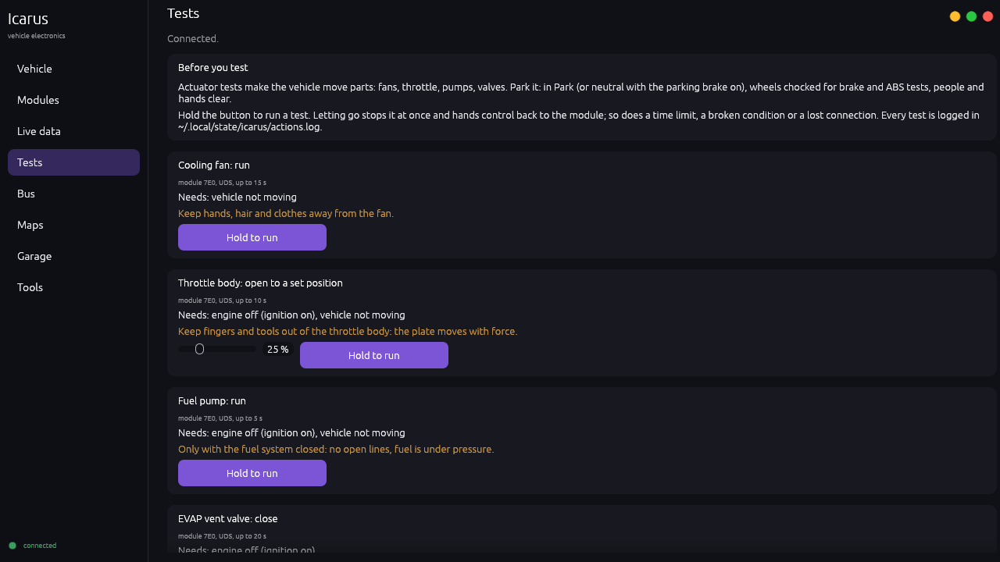
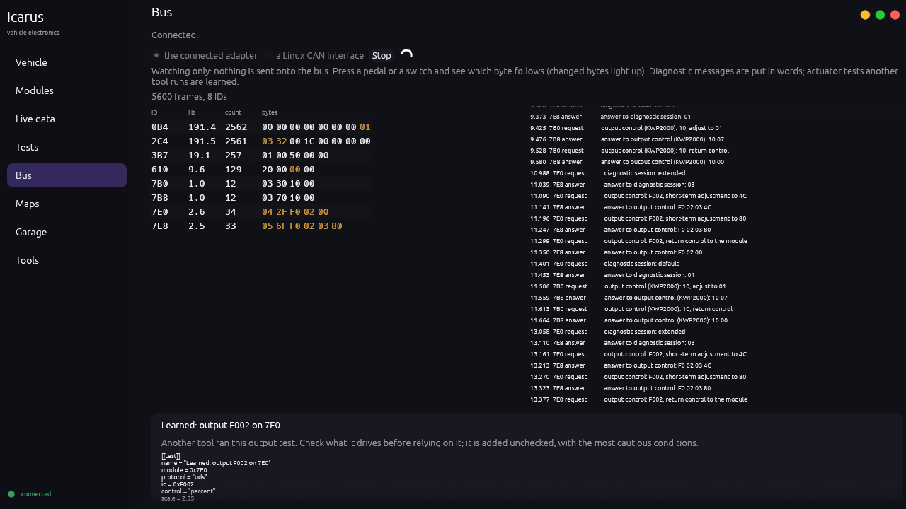
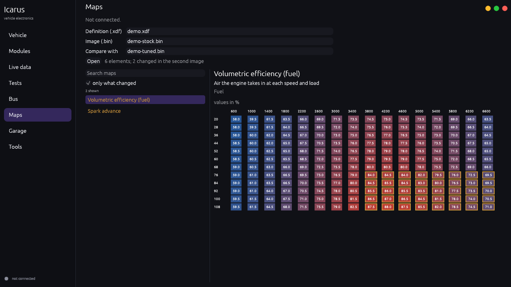
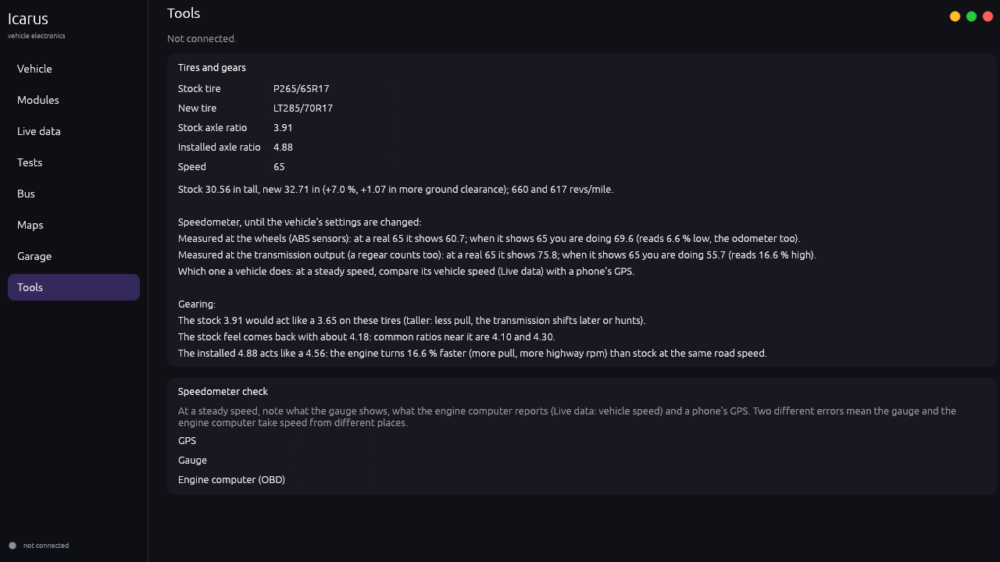

# Icarus

A vehicle tuning, learning and diagnostics tool for Linux: engine, transmission and other control modules (ECU, ECM, PCM,
TCM). I'm building it to learn vehicle electronics hands-on while I build two off-road vehicles, and because no open tool on
Linux tunes factory ECUs.

Part of the Artifex ecosystem (Labyrinth OS, Yggdrasil, Heimdall, Sarina, Daedalus...). Licensed MPL-2.0. Nothing from a real
vehicle is ever in this repository: no VIN, ECU image, calibration or log (the VINs in the tests are made up).

## Screenshots

On the simulated truck (`sim`) and a made-up demo engine; nothing from a real vehicle.

| | |
|:--|:--|
|  **Vehicle**: identity, codes explained with look-up and parts links, freeze frame, readiness |  **Modules**: every module's identity and codes, dealer-tool style |
|  **Live data**: values with what they mean, drawn as they change |  **Tests**: actuator tests, hold to run |
|  **Bus**: every ID and changing byte; another tool's tests learned |  **Maps**: a fuel table, cells another image changed outlined |
|  **Tools**: tires and gears, speedometer check | |

Maps shows, compares and edits tables (fuel, spark, limits): click a cell, type a value or step it, and save the result as a
new file (never over the original), its checksums corrected where they are known. Writing an image to an ECU comes only after
the rules in docs/PLAN.md, on a bench ECU first.

## Icon

 A wheel seen side-on (tyre, rim, hub) with a
three-feather wing sweeping back from the hub: Icarus' wings on a vehicle. I picked it from AI-generated concepts
([docs/icon-concepts.jpg](docs/icon-concepts.jpg), the top-middle one, kept for reference only); the icon is drawn from
scratch, not traced. No text and no background art, so it stays clear at 16 px.

- The glyph in Liki's native form (24x24, fills only, no colour; `liki-build` gives it the tile, the style and the accent
  colour) is in Liki itself, as Yggdrasil's own apps' are: Yggdrasil `packages/liki/share/brand-icons/native/icarus.svg`.
- `packaging/icons/icarus.svg`: the app's own icon in Yggdrasil's look, the glyph in the default accent (124, 84, 214) on the
  dark rounded tile, exactly what Liki's `rounded` shape and `purple` style would make. The package (and `install-local.sh`)
  puts it and the PNGs (`packaging/icons/NxN/icarus.png`, 16 to 512) in hicolor; `icarus.desktop` names `Icon=icarus`, and the window
  carries the 256 px one.
- Every shape and style, and the small sizes: [docs/icon-preview.png](docs/icon-preview.png).

The PNGs are made from the SVG: `rsvg-convert -w N -h N packaging/icons/icarus.svg -o packaging/icons/NxN/icarus.png`.

## Install

Icarus is in Agora (Labyrinth OS's app store, under Utilities), or from Labyrinth's package repository:

```sh
sudo pacman -S icarus-git
```

The package (its recipe is Labyrinth_OS `packages/pkgbuilds/icarus-git`) builds this repository, runs `cargo test
--workspace`, and installs `icarus` and `icarus-app` in `/usr/bin`, Icarus in the app menu with its icon, and the tuner
access rules (`packaging/70-icarus-tuners.rules`, in `/usr/lib/udev/rules.d`). Updates come with the system's, through Agora
or pacman.

To try a checkout without the package:

```sh
bash scripts/install-local.sh            # builds, puts icarus and icarus-app in ~/.local/bin, Icarus in the app menu
bash scripts/install-local.sh --remove   # takes that out again (do this before installing the package: ~/.local/bin comes first)
```

## Trouble codes

Every code comes explained: what it means (standard codes in Icarus's own words, the maker's own codes from the vehicle
profile's `[codes]` table), what the letter and digits say, where to start for the common ones, the parts usually involved,
and links: a web search for the code on this vehicle, and searches for each part plus RockAuto's catalog for the vehicle.
Name a vehicle once (`icarus garage VIN "2017 Toyota Tacoma 3.5L V6"`, or the field on the Vehicle page) so the links name
the model. Searches go to DuckDuckGo unless `ICARUS_SEARCH` is a URL with `{q}`.

```sh
icarus dtc P0304 C1241 --vehicle "2017 Toyota Tacoma 3.5L V6"   # no vehicle needed
icarus obd codes --adapter A                                     # the vehicle's codes, explained, and the freeze frame
icarus obd report --adapter A --scan                             # everything in ~/Documents/Icarus/reports/*.md
```

The freeze frame (service 02) is what the engine was doing when the code set: speed, load, temperatures, fuel trims.

On-board test results (`icarus obd selftests`, Mode 06, CAN vehicles): each emissions monitor's last measurement against
its limits (a catalyst near its limit fails soon) and misfire counts per cylinder; pass or fail compares raw numbers, real
units only where the scaling is certain.

Clearing (`icarus obd clear [--module ID]`, or Clear codes in the window) asks first, needs the engine off, and saves a
report before it erases anything: the freeze frame goes with the codes, and every readiness monitor starts over. Only the
clearing requests go out (OBD-II `04`, UDS `14 FF FF FF`, KWP2000 `14 FF 00`); permanent codes stay until their monitor
passes. Every clear is in `~/.local/state/icarus/actions.log`.

## NHTSA

`icarus vin VIN --nhtsa` (or "Fill in from NHTSA" next to the vehicle's name) asks NHTSA's public vPIC database for the
model, engine, trim and drive; it sends the VIN to NHTSA, so only when asked. `icarus recalls "2017 Toyota Tacoma"` (or the
Recalls card) lists the recalls on record for that year, make and model, sending only those three; whether one vehicle is
affected and still open is a VIN check at nhtsa.gov/recalls (the button opens it).

## Battery and charging

`icarus obd charging --battery agm` (or the Battery and charging card): the voltage the engine computer sees for about 20
seconds, judged for the battery fitted. Engine running: whether the alternator charges it well (an AGM wants about
14.4-14.8 V to finish a charge; under 13 V is not charging, over about 14.8 V overcharges). Engine off after sitting: about
how charged it is. A vehicle with battery management (BMW, VW/Audi, Mercedes, many newer Fords and Rams) also stores the
battery type, set by "battery registration": a per-make configuration change for later.

## Vehicle folders

Every vehicle connected (with a VIN) gets a folder in `~/Documents/Icarus/Vehicles/`, named after the name it was given
(else its VIN; renaming the vehicle renames the folder): **OEM tunes**, **Custom tunes**, **Definitions**, **Reports**
(the vehicle's reports go here) and **Logs**. A stock image imported as OEM is copied in read-only and never replaced: it is
the way back.

## Tires and gears

```sh
icarus tires P265/65R17 LT285/70R17 --gear 3.91 --installed 4.88
```

Taller tires: how far off the speedometer and odometer are (both cases: speed measured at the wheels, or at the
transmission output, where a regear counts too), what the stock and installed axle ratios act like, and which ratios bring
the stock feel back.

## The bus

`icarus bus watch --adapter A` (the OBDLink's monitor mode) or `--can can0` (a Linux CAN interface such as a CANable),
or the Bus page: every ID with its rate and last bytes, the bytes that just changed lit up (press a pedal or a switch and
watch which byte follows), and diagnostic messages between a tool and the modules put in words. Watching only: nothing
is sent onto the bus. What another tool does while Icarus watches is learned (next section).

## Learning from another tool

Icarus learns a vehicle's settings and output tests by watching another tool use them on it: a dealer tool, a shop scan
tool, a phone app that does customizations. A Y-splitter on the OBD port carries both: the other tool on one side, Icarus's
adapter (monitor mode) on the other, or a CAN interface tapped into the bus. Icarus only listens.

```sh
icarus learn --adapter A           # type what you are about to do in the other tool, Enter (a mark), then do it; "stop" ends
icarus learn --can can0 --ask-sarina
```

Or the **Learning** page: Start learning, type what you are about to do and press Mark before each change, Stop and save.

- **What is learned.** A write the module accepted (UDS `2E` answered `6E`, KWP2000 `3B` answered `7B`) becomes a
  `[[setting]]`, with the value the tool read just before (`22`/`21`) as "was" and the written one as "set", and whether
  the tool opened the extended session first. An output-control request (UDS `2F ... 03`, KWP2000 `30 .. 07`) becomes a
  `[[test]]`. A mark names the next one learned; one change per mark works best. Both are unchecked, with the most
  cautious conditions; the airbag modules and immobiliser, key and odometer settings are never learned.
- **What is not learned, but noted.** Security access (the tool unlocking a module), routines (service functions, coding
  steps), writes too long for a setting, memory writes and programming, and writes the module refused, each in words.
- **The session** is saved in the vehicle's `Logs` folder as `learning-DATE-TIME.md`: the module names from Icarus's
  profile, the marks, what was learned, what was noted, and every diagnostic message in words. No VIN.
- **Naming and adding.** On the Learning page each learned setting gets a name and names for its values ("was"/"set"
  become "on"/"off"), and one button adds it to the vehicle's file (`~/.config/icarus/vehicles/MAKE.toml`); the Settings
  and Tests pages then offer it.
- **Sarina**, only when Sarina is installed (Sarina's own `sarina` program, not just Labyrinth's `labyrinth-ask-sarina`,
  which every Labyrinth system has; without Sarina the page says nothing about Sarina): Ask Sarina on a session (or
  `--ask-sarina`) has Sarina read the file
  (`labyrinth-ask-sarina`, read-only) and say what each setting most likely is, names for it and its values, and what the
  tool did that Icarus could not learn. Sarina's answer is a suggestion; the names are mine to give. Sarina can also open
  the sessions through `icarus mcp` (`learning_sessions`).

## Actuator tests (bidirectional controls)

Like the bidirectional controls of shop scan tools: Icarus asks a module to drive one output for a short while (throttle
to a set opening, cooling fan, fuel pump, a valve, the ABS pump) so the part can be checked.

```sh
icarus obd tests --adapter A                                   # the tests known for this vehicle
icarus obd test throttle --adapter A --value 30 --seconds 3    # asks "yes", runs, hands control back
```

In the window (Tests page) a test runs only while its button is held. The fence is in code (`crates/icarus-obd/src/
actuator.rs`): only output control goes out (UDS `2F`, KWP2000 `30`, the session and tester present they need); never
security access, routines, coding, clearing or programming; never airbag or occupant-detection modules; conditions (engine
off or running, vehicle stopped) checked before and every second during a test; at least 11.5 V; a time limit of at most
30 s; control handed back on every way out (release, time, condition, error, Ctrl+C, closed window), and by the module
itself if Icarus dies (its diagnostic session times out); every start and stop in `~/.local/state/icarus/actions.log`.

The tests are data: `[[test]]` entries in a vehicle profile (module, protocol, output ID, on/off or percent, conditions,
time limit, warning, a live value to watch). Their IDs are each maker's own, so a profile carries only IDs from a source,
marked `checked = false` until seen working; none are in the built-in profiles yet. `sim:off` (the simulated vehicle,
ignition on and engine off) has five to try: fan, throttle, fuel pump, EVAP vent valve, ABS pump.

## Module settings

What dealer tools call customizations: a feature a module keeps switched on or off, or a value it keeps (a chime, a lock
behaviour, a light). Icarus learns them by watching such a tool change one on my own vehicle (previous section), and then
changes them itself, on the Settings page (asks first, with the value now and the one chosen) or:

```sh
icarus obd settings --adapter A                                # the settings known for this vehicle, and each one's value now
icarus obd setting "seat belt chime" off --adapter A           # asks "yes", keeps the value before, writes, reads it back
icarus obd setting-undo "seat belt chime" --adapter A          # back to what it was before the last change
```

The fence is in code (`crates/icarus-obd/src/settings.rs`): only reading and writing one data identifier goes out (UDS
`22`/`2E`, KWP2000 `21`/`3B`, the session they need and tester present); never security access, routines or programming;
never airbag or occupant-detection modules, immobiliser or key settings, or odometer values. A change needs a wired adapter
(not Bluetooth or Wi-Fi), the battery at 12 V or more, and its conditions (by default engine off and parked). The value
there before is read and written to the vehicle's `Logs/settings-changes.tsv` before anything is written; the new value is
read back, and if the module did not take it, the old one is written back. Only named values from the profile can be
written: a value never seen on the vehicle goes into its profile first, by hand. Every change is in
`~/.local/state/icarus/actions.log`.

Settings are data too: `[[setting]]` entries (module, protocol, identifier, named values, whether the module needs the
extended session, conditions). None are in the built-in profiles: each maker's are its own, and each module's differ by
model and year, so they come from watching a tool on my own vehicle. `sim:off` has two to try: the cluster's seat belt chime
(UDS) and the ABS module's buzzer (KWP2000).

## Editing maps and checksums

```sh
icarus set IMAGE.bin FILE.xdf "Volumetric efficiency (fuel)" 88 --row 9 --col 10   # a table cell (rows and columns from 0)
icarus set IMAGE.bin FILE.xdf "Rev limit" 7200                                     # a single value
icarus set IMAGE.bin FILE.xdf "Cooling fan on at idle" off                         # a switch
icarus checksums IMAGE.bin FILE.checksums.toml                                      # are the checksums right?
```

Every edit is saved as a new file (`IMAGE-edited.bin` beside it, or in the vehicle's Custom tunes folder when the image is in
its OEM tunes folder; `--out` to choose), never over a file. In the window, the Maps page does the same: click a cell, type a
value (or step it with - and +), Undo this map / Undo all, Save.

Checksums: an ECU checks its calibration against numbers kept in the image, so an edited image needs them corrected. How each
family computes them is its own; a definition's checksums are described in `<definition>.checksums.toml` beside it (sums of
bytes, 16- or 32-bit words, XOR, CRC-16/CCITT, CRC-32; stored as the value or as the complement that makes the sum come out
right; the format is at the top of `crates/icarus-core/src/checksum.rs`). A description is used only if it matches the image
as it was read; one that does not is reported and never "fixes" anything. With no description the checksums are unknown and
the saved file is for study only. No family's description ships yet: each needs a source and a check on a real image.

## Sarina (or another assistant)

`icarus mcp` is a Model Context Protocol server on stdin/stdout with five read-only tools: `explain_code` (what a code
means, where to start, the parts), `vehicle_check` (identity, check-engine light, readiness, codes explained, freeze frame,
current values, on-board test results), `vehicle_modules` (every module's codes), `learning_sessions` (what Icarus saved
while watching another tool) and `tires_gears`. Nothing that clears
codes, runs a test or writes is offered to a model; a test fails if a tool with such a name appears. The adapter comes from
`ICARUS_ADAPTER` in the server's environment (`sim` for the simulated vehicle). For Sarina, a definition file of its own:

```json
{"mcpServers": {"icarus": {"command": "/home/me/.local/bin/icarus", "args": ["mcp"],
  "env": {"ICARUS_ADAPTER": "bt:AA:BB:CC:DD:EE:FF"}, "read_only": true, "timeout_seconds": 120}}}
```

named by `SARINA_MCP_FILE` when Sarina should have it (in `~/.sarina/mcp.json` Sarina's nightly evals would see the five
tools too).

## The window

`icarus-app` (Icarus in the app menu): the **Vehicle** page connects to the adapter and shows the VIN, the make's profile,
the codes explained with Look up and parts buttons, the freeze frame, the check-engine light and readiness monitors, the
vehicle's name, and Save report; **Modules** scans every module for its identity and codes;
**Live data** picks values and draws them as they change, each with what it means; **Tests** runs actuator tests while a
button is held; **Settings** shows each module setting's value and changes it (asks first; undo puts the last change
back); **Learning** watches another tool and names what it learned; **Bus** shows every ID and message; **Maps** opens a
definition and an image
(and a second image to compare: it starts on the first map the second one changed, changed cells outlined). Start options:
`--connect [--adapter A] --page modules --scan`, `--live`, `--maps DEF.xdf IMAGE.bin [SECOND.bin]`, `--learn [--mark TEXT]
[--learn-seconds N]` (a learning watch at start, for demonstrations).

## What it does today

Everything below only reads, except the actuator tests, which drive a part for as long as you hold the button, and module
settings (both above).

**Files** (no vehicle needed):

```sh
icarus def FILE.xdf [--find TEXT]                 # what a TunerPro definition describes; --find searches map names
icarus show IMAGE.bin FILE.xdf NAME               # one map, curve or value from an image, in real units
icarus diff ORIGINAL.bin TUNED.bin --def FILE.xdf # what a tune changed, map by map and cell by cell
```

`diff` is the quickest way to learn from an existing tune: give it the stock image and a modified one, and it names every
map that changed and shows each cell's old and new value.

**Vehicle**, through an OBD-II adapter:

```sh
icarus obd info  --adapter A    # adapter, protocol, VIN, modules, calibration IDs, check-engine light, readiness monitors
icarus obd codes --adapter A    # stored, pending and permanent trouble codes per module
icarus obd pids  --adapter A    # the live values each module offers, and what each one means
icarus obd live  --adapter A 0C 06 07 14 44 --csv run.csv   # watch values (PIDs in hex), optionally into a CSV log
icarus obd scan  --adapter A --make toyota   # every module (ABS, airbags, cluster...): identity and trouble codes
icarus obd module 7B0 --adapter A            # one module, by its request ID
```

`scan` and `module` work like a dealer tool (Techstream, FORScan): they talk to each module directly in UDS (ISO 14229) or
the older KWP2000 that many Toyota modules still use, not only to the engine's standard OBD-II side. A guard in the code lets
only reading services out: clearing codes, writing, actuator tests and programming are refused until the safety steps exist.

**Vehicles.** Icarus is for any make: what it knows about each one (where its modules answer, its quirks) is a small TOML
file in `crates/icarus-obd/vehicles/`, picked by the VIN. Built in: Toyota/Lexus, Subaru, Ford/Lincoln, GM, Stellantis,
Honda/Acura, Nissan, Hyundai/Kia, Mazda, VW/Audi, BMW/Mini, Mitsubishi, and a generic OBD-II profile. A file of the same name
in `~/.config/icarus/vehicles/` replaces a built-in one, and a new name adds a make, so a module found on a vehicle can be
written down without rebuilding. Addresses from public sources are marked "not yet checked" until seen on a real vehicle.

```sh
icarus vin VIN       # where it was built, maker, model year, check digit
icarus vehicles      # the makes Icarus knows
```

The adapter `A` is one of:

| | |
| --- | --- |
| `sim` | a simulated vehicle (engine + transmission, a P0171 lean code to diagnose): try everything without a car |
| `bt:AA:BB:CC:DD:EE:FF` | a paired Bluetooth adapter such as the OBDLink MX+ (RFCOMM channel 1; `#2` picks another) |
| `/dev/ttyUSB0[@115200]` | a USB adapter (38400 baud unless given) |
| `tcp:192.168.0.10:35000` | a Wi-Fi adapter |

`ICARUS_ADAPTER` sets a default. Pair a Bluetooth adapter once with `bluetoothctl` (`scan on`, `pair`, `trust`); Icarus
connects to it directly, no `rfcomm bind` needed.

## Build

```sh
cargo test --workspace
cargo build --release      # target/release/icarus
```

Rust (stable), Linux. Dependencies: `roxmltree` (XML) and `libc`.

## Layout

| Crate | What |
| --- | --- |
| `crates/icarus-core` | ROM images (original + edited, diff), definitions (tables, values, switches), formulas, the TunerPro `.xdf` reader |
| `crates/icarus-obd` | adapters (USB, Bluetooth, Wi-Fi, simulated), the ELM327/STN language, the standard OBD-II services |
| `crates/icarus` | the `icarus` command |
| `crates/icarus-app` | the window (egui, Yggdrasil's look from yggdrasil-ui); a worker thread owns the adapter |

## Where it is going

See [docs/PLAN.md](docs/PLAN.md): reading a factory ECU's memory, editing maps with checks, flashing with a verified backup,
transmission modules, a CAN bus view, and a desktop app.

## What Icarus will not do

- Ship one-click emissions "delete" features. Thresholds and calibration values (what sets what off) are ordinary maps, and
  emissions readings (oxygen sensors, lambda, fuel trims, catalyst temperature, monitors) are part of the live data.
- Bypass immobilizers or change odometer readings.
- Flash or recode a module without a verified full backup first (the writes so far: actuator tests, clearing codes and
  module settings, each with the value before kept and a way back).

## Version

`VERSION` is Icarus's own version (1.0.0 since 2026-11-11, its first numbered release), for when it is packaged. How the numbers work and how to make a release: [Labyrinth_OS docs/VERSIONING.md](https://github.com/Artifex-Technologies/Labyrinth_OS/blob/main/docs/VERSIONING.md).

## Licence

MPL-2.0, like the rest of the ecosystem. The reference projects I looked at are GPL or proprietary: Icarus takes ideas and
file formats from them, never code.
