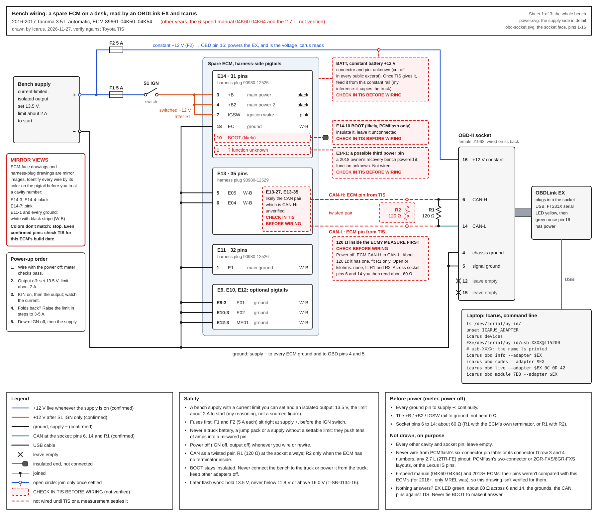
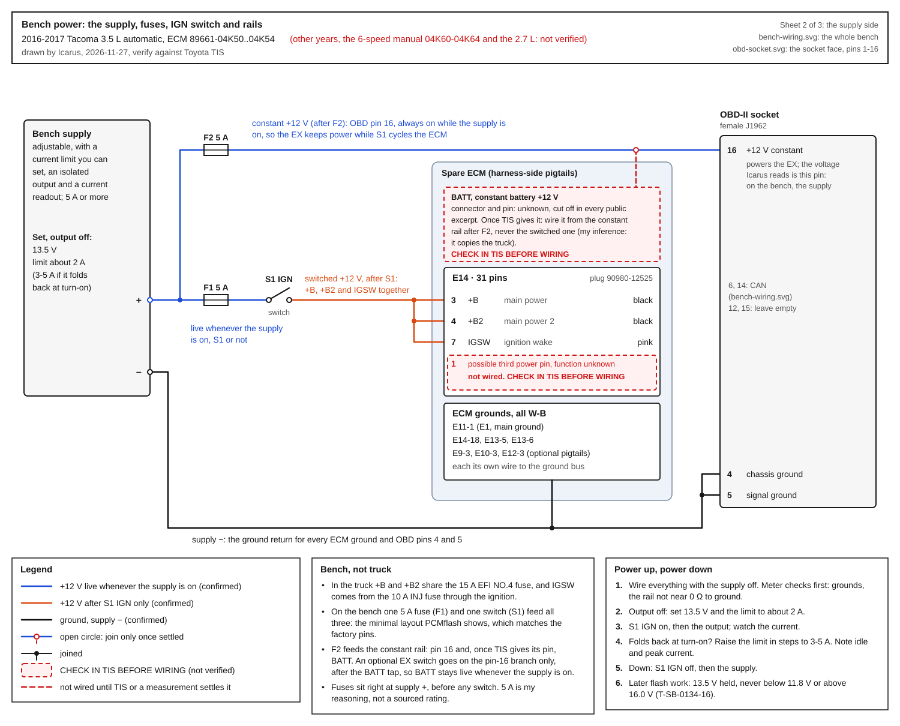
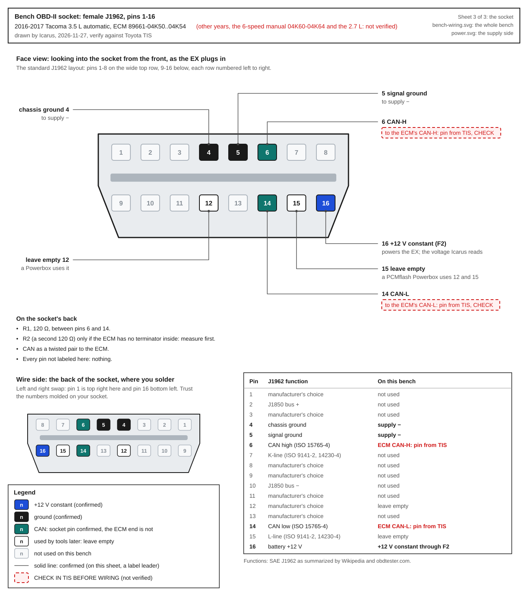

# Bench wiring: 2016-2017 Tacoma 3.5 L automatic ECM

This is how I run a spare engine ECM on a desk and read it with an OBDLink EX and Icarus. The point is to learn how the ECM
behaves before anything writes to the one in my truck. The folder is named for the whole third generation (2016-2023). The
drawings and this page cover only one ECM: the **2016-2017 Tacoma 3.5 L (2GR-FKS) with the automatic**, a Denso unit
labeled **89661-04K50 to 04K54**, with six connectors, E9 to E14. I haven't verified any other year.

## What this is and what it isn't

It is:
- the wiring to power a spare ECM and talk to it over CAN through a female OBD-II socket: power, ignition, ground and CAN,
  nothing else. Two 3rd-gen Tacoma owners brought ECMs back to life on a desk with just that
  ([2017 truck](https://www.tacomaworld.com/posts/29363614), [2018 truck](https://www.tacomaworld.com/threads/bricked-ecu.799094/page-6));
- for reading: identity, calibration IDs, trouble codes, live data;
- drawn only from pins I could confirm in public sources (listed below). Every pin I couldn't confirm is a dashed red
  **CHECK IN TIS BEFORE WIRING** box, never a plain connection.

It isn't:
- a pinout for other ECMs: 2018 automatics (89661-04K2x), 2019-2020 automatics (04L0x), the 6-speed manual (04K60-04K64),
  any 2.7 L (2TR-FE: same plug shapes, different pins) or the Lexus IS 2GR-FKS (two connectors). Between the 2016-2017 and
  later excerpts only one pin (MREL) has been compared;
- a substitute for Toyota's own ECM terminal table. A $30 two-day TIS pass settles the open pins, and it comes first;
- a backup, flash or recovery rig. Those need a J2534 cable from a tool's tested list, licensed bench software and control
  of the BOOT pin. The EX isn't a J2534 cable and can't drive a boot pin ([EX product page](https://www.obdlink.com/products/obdlink-ex/)).
  That comes later, after the reads here are proven;
- anything connected to the truck. The bench never touches the truck, and the truck never powers the bench.

## The drawings

| File | What it shows |
| --- | --- |
| [bench-wiring.svg](bench-wiring.svg) | The whole bench: supply, fuses, IGN switch, the E14, E13 and E11 pigtails (and the optional E9, E10, E12 grounds), the OBD socket, R1 and R2, the EX and the laptop |
| [power.svg](power.svg) | The supply side: F1 and F2, the IGN switch, the +B/+B2/IGSW rail, the constant pin-16 feed, the ground return, and where BATT goes once TIS gives its pin |
| [obd-socket.svg](obd-socket.svg) | The female J1962 socket's face, pins 1-16, with the bench's pins labeled, and the mirrored wire side |

Solid lines are confirmed connections. A dashed red box means CHECK IN TIS BEFORE WIRING: the pin isn't verified, and
nothing is wired to it until TIS or a measurement settles it. Blue is +12 V that is live whenever the supply output is on
(supply +, through F1 up to the IGN switch, and everything after F2); orange is +12 V after the IGN switch only; black is
ground; teal is CAN at the socket (pins 6 and 14 and R1), while the run to the ECM stays dashed red.







## Parts

What I need now:

| Part | Why | Rough price |
| --- | --- | --- |
| Spare ECM, 2016-2017 Tacoma 3.5 L automatic, labeled 89661-04K50 to 04K54 (a retailer lists 04K55 as superseding them) | Same hardware family as the truck it stands in for. Toyota's [T-SB-0077-16](https://static.nhtsa.gov/odi/tsbs/2016/MC-10132910-9999.pdf) and [T-SB-0062-18](https://static.nhtsa.gov/odi/tsbs/2018/MC-10143932-9999.pdf) reflash 04K50-04K53 into 04K54 without swapping the ECM. Read the truck's label first and match it | about $105-200 used on eBay, about $175 at a junkyard (TacomaWorld members, Nov 2023) |
| Toyota TIS 2-day Standard pass | The ECM terminal table and the 2GR-FKS wiring diagram: CAN-H and CAN-L, BATT, BOOT and every power pin, before power | $30 ([TIS](https://techinfo.snapon.com/TIS/Register.aspx)) |
| Adjustable bench supply with a current limit you can set, a current readout and an isolated output, rated 5 A or more | Holds 13.5 V and folds back before a miswired pin can burn the ECM or the harness | roughly $50-150 (my estimate) |
| Two inline blade-fuse holders, 5 A fuses, a toggle switch (IGN; optionally a second one to turn the EX off, on the pin-16 branch only, after the BATT tap, so BATT stays live whenever the supply is on) | Fused +12 V; the IGN switch feeds +B, +B2 and IGSW, so I get power cycles | about $10-20 (estimate) |
| ECM pigtails E14, E13 and E11 with several inches of wire, from a salvaged 3rd-gen 3.5 L harness (housings 90980-12525, -12529, -12526); E9, E10 and E12 optional | Proper mating plugs. Clip-on leads can short neighboring pins | not checked (salvage yard or eBay) |
| Female OBD-II (J1962) socket or breakout | So the EX (and later a J2534 cable) plugs in normally | about $10-20 (estimate) |
| Two 120 Ω resistors, 1/4 W | CAN needs termination on the bench: R1 always, R2 only if the ECM has no terminator inside | pennies |
| Digital multimeter | Unpowered checks, and comparing Icarus's voltage reading with the supply | about $20-50 (estimate) |
| Wire (twisted pair for CAN), crimp terminals, heat shrink, labels | Building and labeling the harness | about $10-25 (estimate) |

Optional:

| Part | Why | Rough price |
| --- | --- | --- |
| Chiptuningshop Universal ECU Bench Cable (OBD-UCC8) | A ready-made female OBD port with switched power and ignition, a 60/120/off termination switch and boot resistors. I'd still supply the ECM-side pins | £80 excluding tax, supply not included |
| Oscilloscope | Tells CAN-H from CAN-L while a tool talks, if TIS doesn't settle it | not priced |

Later, for backups, flashing and recovery (not for this bench):

| Part | Why | Rough price |
| --- | --- | --- |
| A J2534 cable on PCMflash module 49's tested list: a Mongoose-Plus MFC3 VIM, a genuine Tactrix OpenPort 2.0 or a Scanmatik | Real flash and EEPROM backup, restore and bench recovery. The Washinglee clone isn't on the list, so it gets proven on the spare only | Mongoose-Plus MFC3 VIM $545 from Toyota (TSLP3AM01); a genuine OpenPort 2.0 is out of production (about $160 in 2025) |
| PCMflash dongle with modules 46 (OBD flash) and 49 (Gen2 bootloader flash and EEPROM), after my legal check | The listed route to a whole-ECU backup and bench recovery | $31 + $149 + $149 ([ecutools.eu](https://ecutools.eu/chip-tuning/pcmflash)) |
| PCMflash Powerbox and its DB15 cable | Switches power and BOOT through OBD pins 12 and 15 for module 49 | $197 + $35 cable, listed out of stock ([iobd.io](https://iobd.io/powerbox-pcmflash)) |
| Toyota TIS 2-day Professional Diagnostic | Techstream and calibration files for Toyota's own reflash, VIN write and ECU communication ID registration | $80, plus a VIM |

## Building it, step by step

1. **Get the TIS pass first.** For the spare's production date, save the ECM terminal table, the "Engine Control (2GR-FKS)"
   wiring diagram and the connector list. Write down BATT, CANH and CANL, BOOT if it's listed, and any other +B pin. Each
   one fills a CHECK box on the drawings; until then, that box stays unwired.
2. **Read the label.** The truck's ECM sits behind the glove box ([TacomaWorld](https://www.tacomaworld.com/posts/24278323)).
   Photograph the label, write down the 89661- number and count the plugs (six, E9 to E14), without unplugging anything.
   Do the same on the spare.
3. **Get the pigtails** with several inches of wire: at least E14 (power), E13 (CAN) and E11 (main ground).
4. **Identify every wire by color before trusting a cavity number.** The ECM-face drawings and the harness-plug drawings
   are mirror images. E14-3 and E14-4 should be black, E14-7 pink, E11-1 and every ground white with a black stripe (W-B).
   If the colors don't match, stop.
5. **Wire the bench with the power off** (the minimal layout PCMflash shows, which matches the factory pins):
   - supply + → F1 (5 A) → S1 (IGN) → E14-3 (+B), E14-4 (+B2) and E14-7 (IGSW). In the truck, +B and +B2 share one fuse;
   - supply + → F2 (5 A) → OBD pin 16, constant, so the EX gets power and Icarus's voltage reading sees the supply;
   - supply − → E11-1 (E1), E14-18, E13-5 and E13-6 (and E9-3, E10-3, E12-3 with those pigtails) → OBD pins 4 and 5;
   - the ECM's CAN pair → OBD pin 6 (CAN-H) and pin 14 (CAN-L) as a twisted pair, **only once TIS says which pin is which**;
   - R1 (120 Ω) between socket pins 6 and 14;
   - BOOT (E14-10, likely): insulate it and leave it unconnected;
   - BATT: off until TIS gives the pin, then from the constant side after F2 (my inference: it copies the truck);
   - nothing else. Socket pins 12 and 15 stay empty.
6. **Check with the meter, power off:**
   - every ground pin has continuity to supply −;
   - the +B/+B2/IGSW rail doesn't read near 0 Ω to ground;
   - CAN-H to CAN-L at the ECM: about 120 Ω means it has a terminator inside, so I fit R1 only, which gives about 60 Ω.
     Open or kilohms means it has none, so I fit R1 and R2 (R2 in parallel with R1), which also gives about 60 Ω, the
     value that meets the spec ([ELM AN05](https://hallaweb.jlab.org/tech/Detectors/public_html/manuals/chip_specs/A-L/elm_electronics/AppNote05.pdf);
     it adds that one 100-120 Ω resistor works just as well, but fitting both keeps every check here at 60 Ω);
   - measure again across socket pins 6 and 14 before power: about 60 Ω either way.
7. **First power-up:**
   - supply output off; set 13.5 V and the current limit to about 2 A (my reasoning, not a sourced figure);
   - S1 IGN on, then the output; watch the current;
   - if the supply folds back at turn-on, raise the limit in steps to 3-5 A. ECU high-voltage circuits draw a large startup current
     ([PCMflash Powerbox page](https://ecutools.eu/chip-tuning/powerbox_pcmflash));
   - write down the idle and peak current.
8. **Connect the laptop.** Plug the EX into the bench socket and its USB cable into the laptop. Its LED should go from
   yellow to green once pin 16 has power ([EX quick start](https://www.obdlink.com/windows_qsg_ex/)). Then `lsusb`,
   `ls /dev/serial/by-id/` and `icarus devices`.
9. **Read with Icarus** (next section).
10. **Power down:** S1 IGN off, then the supply.

If nothing answers, check in this order: the EX's LED is green (pin 16 has power), about 60 Ω across pins 6 and 14, the
grounds, the CAN pins against TIS. Never connect BOOT to make it answer.

## Wiring table

| From | To | Pigtail wire | Status | Source |
| --- | --- | --- | --- | --- |
| supply + → F1 5 A → S1 IGN | E14-3, +B (main power) | black (through IA2-1 in the truck) | confirmed | [factory diagram excerpt](https://www.tacomaworld.com/posts/24259231); PCMflash drawing A3 ([manual](https://pcmflash.ru/downloads/pcmflash_46.pdf?108)) |
| the same rail | E14-4, +B2 (main power 2) | black (IA2-2) | confirmed; the truck feeds +B and +B2 from the same 15 A EFI NO.4 fuse | [factory diagram excerpt](https://www.tacomaworld.com/posts/24259231) |
| the same rail | E14-7, IGSW (ignition) | pink (IH1-5 and EA1-14, from the 10 A INJ fuse) | confirmed | [excerpt](https://www.tacomaworld.com/posts/24259231), [INJ fuse circuit](https://www.tacomaworld.com/posts/24259137), [forum](https://www.tacomaworld.com/posts/30412449); PCMflash drawing A7 |
| supply − | E11-1, E1 (main ground) | W-B | confirmed | [ground excerpt](https://www.tacomaworld.com/posts/29985844), [2017 excerpt](https://www.tacomaworld.com/posts/29480256); PCMflash D1 |
| supply − | E14-18 (EC), E13-5 (E05), E13-6 (E04) | W-B | confirmed | [ground excerpt](https://www.tacomaworld.com/posts/29985844) |
| supply − | E9-3 (E01), E10-3 (E02), E12-3 (ME01), only with those pigtails | W-B | confirmed | [ground excerpt](https://www.tacomaworld.com/posts/29985844) |
| supply + → F2 5 A, constant | OBD pin 16 | any | confirmed (J1962) | [Wikipedia](https://en.wikipedia.org/wiki/On-board_diagnostics), [obdtester](https://obdtester.com/obd2_connector) |
| supply − | OBD pins 4 (chassis ground) and 5 (signal ground) | any | confirmed (J1962) | [Wikipedia](https://en.wikipedia.org/wiki/On-board_diagnostics), [obdtester](https://obdtester.com/obd2_connector) |
| the ECM's CAN-H | OBD pin 6 | twisted pair; color not found | **CHECK IN TIS**: likely E13-27 or E13-35, which one is high is unverified | [PCMflash](https://pcmflash.ru/downloads/pcmflash_46.pdf?108) B27/B35, [2017 Tacoma post](https://www.tacomaworld.com/posts/27556798) |
| the ECM's CAN-L | OBD pin 14 | twisted pair; color not found | **CHECK IN TIS**, as above | as above |
| R1, 120 Ω | between OBD pins 6 and 14, at the socket | | always | [ELM AN05](https://hallaweb.jlab.org/tech/Detectors/public_html/manuals/chip_specs/A-L/elm_electronics/AppNote05.pdf) |
| R2, 120 Ω | in parallel with R1 | | **measure first**: only if the ECM has no terminator inside | the unpowered measurement in step 6 |
| nothing | OBD pins 12 and 15 | | leave empty; a PCMflash Powerbox uses them for boot and power control | [Powerbox](https://iobd.io/powerbox-pcmflash) |
| nothing, insulated | E14-10, BOOT (likely) | | **CHECK IN TIS**; never connected on this bench | [PCMflash guide](https://pcmflash.ru/downloads/pcmflash_46.pdf?108): ground BOOT "for ECU recovery only" |
| not wired | BATT, constant battery | | **CHECK IN TIS**: the pin is cut off in every public excerpt | none |
| not wired | E14-1, a possible third power pin | | **CHECK IN TIS**: a 2018 owner's recovery bench powered it; function unknown | [thread](https://www.tacomaworld.com/threads/bricked-ecu.799094/page-6) |

## Verified, and what to check in TIS

Verified. Even so, I match the wire color and check TIS for the ECM's build date before power: the +B/+B2/IGSW excerpt
comes from a 2018 V6 thread and has no model year printed.

- **Connectors:** six, E9 to E14, tagged E9(E), E10(F), E11(G), E12(H), E13(I), E14(J) on the factory diagrams. Pin counts
  E9 34, E10 35, E11 32, E12 33, E13 35, E14 31. All six harness plugs are white; housings E9 90980-12527, E10 -12528,
  E11 -12526, E12 -12700, E13 -12529, E14 -12525 ([connector list](https://www.tacomaworld.com/posts/29985846),
  [ECM-face drawing](https://www.tacomaworld.com/posts/29985843)).
- **Mirror views:** the harness-plug drawing numbers row 1 as 1..7 from left to right; the ECM-face drawing and PCMflash
  number it 7..1 ([E14 view](https://www.tacomaworld.com/posts/30158103)). The wire color on the pigtail settles it.
- **PCMflash's letters** go by housing shape: F = E9, E = E10, D = E11, C = E12, B = E13, A = E14. They don't match the
  diagram's circled letters, so I never mix the two.
- **Pins:** E14-3 +B, E14-4 +B2, E14-7 IGSW, E11-1 E1, and the grounds E9-3, E10-3, E12-3, E13-5, E13-6, E14-18. Two more
  are confirmed but not needed on the bench, so they stay unconnected: MREL (E14-25, the EFI-MAIN relay) and FPC (E13-9,
  the fuel pump).
- **The OBD socket:** 16 power, 4 and 5 ground, 6 CAN-H, 14 CAN-L.

Check in TIS before wiring:

| Item | Best current answer | How to settle it |
| --- | --- | --- |
| The CAN pair | E13-27 and E13-35, likely (PCMflash B27/B35 and a 2017 Tacoma post) | TIS terminal table |
| Which CAN pin is high | PCMflash says E13-27 is CAN-H; the forum post can be read the other way. Unverified | TIS, or a scope while a tool talks: CAN-H rises toward 3.5 V, CAN-L falls toward 1.5 V ([post](https://www.tacomaworld.com/posts/30052064)) |
| BOOT | E14-10, likely, PCMflash only. PCMflash module 46 grounds it only for recovery, module 49 wires it to a Powerbox, and BitBox says grounding it "will not work" | Leave it unconnected |
| BATT | Unknown. The Lexus IS pin doesn't carry over | TIS terminal table |
| A third power pin | E14-1 by the housing match (PCMflash's A1), powered on a 2018 owner's working recovery bench; function unknown | TIS terminal table |
| A 120 Ω terminator inside the ECM | Unknown | Measure CAN-H to CAN-L on the unpowered ECM |
| Connector count | Six per the factory 2GR-FKS list; a forum-quoted manual line says five (possibly the 2.7 L) | Count them |
| 2016-2017 vs 2018+ pins | Only MREL has been compared | TIS for the production date |
| MREL and CAN wire colors | Not found | TIS |

Never wire from:
- PCMflash's six-connector pin **table** (its own drawing and the factory diagram disagree with it); go by the drawing and
  the factory pins above;
- PCMflash's row numbers for connector D's rows 3 and 4, which are printed wrong;
- any 2.7 L (2TR-FE) pinout, such as the C153/C154/C155/G180/G181 diagram: the housings are the same shape, the pins are not;
- PCMflash's two-connector 2GR-FKS layout, its 2GR-FXS/8GR-FXS layout, or the Lexus IS pins: different ECMs.

## Safety

- A supply with a current limit you can set and an isolated output, the limit low at first, so a short can't burn the
  wiring ([HP Academy](https://www.hpacademy.com/forum/efi-wiring-fundamentals/show/12v-bench-test-unit/)).
- Fuses right at supply +, before any switch. 5 A is my reasoning, not a sourced rating.
- Never a truck battery, a jump pack or a plain high-current supply: they push tens of amps into a miswired pin. The
  Mean Well LRS-350-12 suggested on TacomaWorld has no settable limit and only cuts out at about 32-41 A
  ([spec](https://www.meanwell.com/Upload/PDF/LRS-350/LRS-350-SPEC.PDF)).
- Power off whenever I wire or rewire. CAN as a twisted pair.
- For any later flash work: hold 13.5 V, never below 11.8 V, never above 16.0 V
  ([T-SB-0134-16](https://static.nhtsa.gov/odi/tsbs/2016/MC-10149217-9999.pdf)).
- The bench stays separate from the truck, and other adapters stay off.
- BOOT stays unconnected for all normal work.
- No clearing codes, tests, settings or service routines on the bench yet (see the Read-Only gap below).
- The truck's own ECM stays in the truck, untouched, until the spare has passed every step.

## What Icarus does on the bench

Today, reading only, over the EX:

```sh
ls /dev/serial/by-id/           # the EX's stable name, starting with usb-
unset ICARUS_ADAPTER            # and the Bluetooth adapter switched off and away
icarus devices                  # the EX shows up as an FT231X USB-serial (OBDLink SX/EX and others)
EX=/dev/serial/by-id/usb-XXXX@115200   # replace usb-XXXX with the name ls printed; the EX answers at 115200 (a bare path tries 38400 first)
icarus obd info  --adapter $EX  # adapter, voltage, protocol, VIN, ECU names, calibration IDs, CVNs, modules, monitors
icarus obd codes --adapter $EX  # stored, pending and permanent codes, explained
icarus obd live  --adapter $EX 0C 0D 42   # live data; PID 42 is the ECM's own voltage reading
icarus obd module 7E0 --adapter $EX       # the engine ECM's identity and codes (also 700)
```

`icarus obd pids`, `icarus obd scan --make toyota` and `icarus obd data 700` work the same way. None of these sends
anything Icarus counts as a change.

What I expect to see: protocol 6 (CAN, 11-bit, 500 kbit/s); 7E8 answering, and maybe 7E9 (the second processor; a 7E9
answer is data, not proof of a truck); the donor's VIN and both calibration IDs; B2799 (immobilizer communication) and
many codes for missing sensors, which is normal on a desk. I compare the voltage reading with the meter.

Gaps to know about:
- **Voltage:** the reading is pin 16, which on the bench is the supply, so the charging check would call 13.5 V "full".
- **The Read-Only switch** is keyed by VIN, and the donor's VIN isn't on my list, so Icarus would allow clearing, tests and
  settings on the bench ECM. I don't use them there.
- **Storage:** `obd scan` and `obd module` save their results in a garage folder named by the VIN they read, so the donor
  gets its own folder under ~/Documents/Icarus/Vehicles. It holds a real VIN and stays out of any repository.
- **The window** auto-connects to the last adapter or a paired Bluetooth one, which could be the truck's adapter. On the
  bench I use the command line.
- **Bus watch:** a watch doesn't acknowledge frames, so the ECM's own frames go unacknowledged and it sits in CAN's
  error-passive state. That's harmless.

What comes later (backups, flashing, recovery):
- a whole backup of this ECM: the main flash, the second (transmission) processor's flash and the EEPROM area, kept byte
  for byte, each read twice with matching SHA-256 hashes, plus an identity record. Today that comes only from outside
  tools (PCMflash module 46 over OBD with a listed J2534 cable; module 49 on the bench with BOOT control), and only after
  my legal check;
- restoring, flashing and bench boot mode;
- planned before that, on the simulated ECU first: a bench check that stays read-only whatever the VIN, a backup vault, a
  restore gate and the recovery ladder below. Flashing follows the conditions in
  [docs/DESIGN.md](../../docs/DESIGN.md) ("Never brick a module", "Writing a module (flash): the conditions").

## The recovery ladder, briefly

The ECM is a Denso Gen2 (Renesas 76F0196/198/199/219 family, [BitBox](https://www.bitsoftware.com/bitbox/catalog/8)),
with "Main" and "Sub" calibrations ([T-SB-0077-16](https://static.nhtsa.gov/odi/tsbs/2016/MC-10132910-9999.pdf)), so very
likely two processors. Least invasive first:

0. **Don't need it.** A verified whole backup before any write; flash only at 13.5 V, with the laptop on AC and a wired
   link; the truck's ECM untouched until the spare has passed every rung.
1. **Retry the write over OBD** in normal programming mode (key off, key on without starting, write again), or Toyota's
   own reflash with Techstream. That puts back Toyota's latest stock calibration, not my backup.
2. **Restore this ECU's own verified backup** with the tool that made it.
3. **Bench boot mode through the BOOT pin** (E14-10, likely), without opening the case: PCMflash module 49 with a listed
   cable and a Powerbox. The tools disagree on the BOOT pin, so I follow each tool's own instructions, and BOOT is never
   left tied. Bench reads aren't passive: read again after an interrupted read, and read the main flash after EEPROM work.
4. **Board level:** documented only for Gen1, so unavailable for this ECM.
5. **Replace the ECM.** Toyota's route: a same-family part, the VIN written with Techstream, the ECU communication ID
   registered as TIS directs, B2799 cleared. Restoring the truck's own whole backup to a same-part replacement is in
   scope but unproven: Toyota says ECUs "have internal security that will not allow them to be programmed with another
   ECU's information" ([T-SB-0134-16](https://static.nhtsa.gov/odi/tsbs/2016/MC-10149217-9999.pdf)).

Never: a donor's image or EEPROM onto the truck; the truck's backup into another vehicle; decoding or editing immobilizer
bytes; anything that starts the truck without its registered keys or skips Toyota's authorization.

## Sources

Nothing here is copied from these. The drawings are my own, from what each source shows; [docs/REFERENCES.md](../../docs/REFERENCES.md)
credits them.

- TacomaWorld members' factory wiring-diagram excerpts:
  [+B, +B2, IGSW, FPC](https://www.tacomaworld.com/posts/24259231),
  [INJ fuse circuit](https://www.tacomaworld.com/posts/24259137),
  [IGSW](https://www.tacomaworld.com/posts/30412449),
  [grounds](https://www.tacomaworld.com/posts/29985844),
  [2017 MREL and E1](https://www.tacomaworld.com/posts/29480256),
  [2023 MREL](https://www.tacomaworld.com/posts/30158080),
  [ECM-face drawing](https://www.tacomaworld.com/posts/29985843),
  [connector list](https://www.tacomaworld.com/posts/29985846),
  [E14 view](https://www.tacomaworld.com/posts/30158103),
  [2017 Tacoma CAN post](https://www.tacomaworld.com/posts/27556798),
  [CAN levels](https://www.tacomaworld.com/posts/30052064),
  [2.7 L ECM photo](https://www.tacomaworld.com/posts/29349181),
  [ECM location](https://www.tacomaworld.com/posts/24278323),
  [2017 bench revival](https://www.tacomaworld.com/posts/29363614),
  [bricked-ECU thread](https://www.tacomaworld.com/threads/bricked-ecu.799094/page-6)
- PCMflash's manual, v1.08 ([pcmflash_46.pdf](https://pcmflash.ru/downloads/pcmflash_46.pdf?108)), the
  [PCMflash modules](https://ecutools.eu/chip-tuning/pcmflash), the [Powerbox](https://ecutools.eu/chip-tuning/powerbox_pcmflash)
  and its [listing](https://iobd.io/powerbox-pcmflash)
- Toyota TSBs on NHTSA: [T-SB-0077-16](https://static.nhtsa.gov/odi/tsbs/2016/MC-10132910-9999.pdf),
  [T-SB-0062-18](https://static.nhtsa.gov/odi/tsbs/2018/MC-10143932-9999.pdf),
  [T-SB-0043-20](https://static.nhtsa.gov/odi/tsbs/2020/MC-10174914-9999.pdf),
  [T-SB-0092-20](https://static.nhtsa.gov/odi/tsbs/2020/MC-10181772-9999.pdf),
  [T-SB-0134-16](https://static.nhtsa.gov/odi/tsbs/2016/MC-10149217-9999.pdf),
  [T-SB-0057-18](https://static.nhtsa.gov/odi/tsbs/2018/MC-10143927-9999.pdf)
- The J1962 socket: [Wikipedia, On-board diagnostics](https://en.wikipedia.org/wiki/On-board_diagnostics),
  [obdtester](https://obdtester.com/obd2_connector)
- CAN termination: [ELM Electronics AN05](https://hallaweb.jlab.org/tech/Detectors/public_html/manuals/chip_specs/A-L/elm_electronics/AppNote05.pdf)
- The EX: [product page](https://www.obdlink.com/products/obdlink-ex/), [quick start](https://www.obdlink.com/windows_qsg_ex/)
- Bench supply safety: [HP Academy](https://www.hpacademy.com/forum/efi-wiring-fundamentals/show/12v-bench-test-unit/),
  [Mean Well LRS-350 spec](https://www.meanwell.com/Upload/PDF/LRS-350/LRS-350-SPEC.PDF)
- The ECM family: [BitBox](https://www.bitsoftware.com/bitbox/catalog/8), [Toyota Flasher's TLFReader](https://toyotaflasher.com/tlfreader.html)
- Toyota TIS: [subscriptions](https://techinfo.snapon.com/TIS/Register.aspx)
